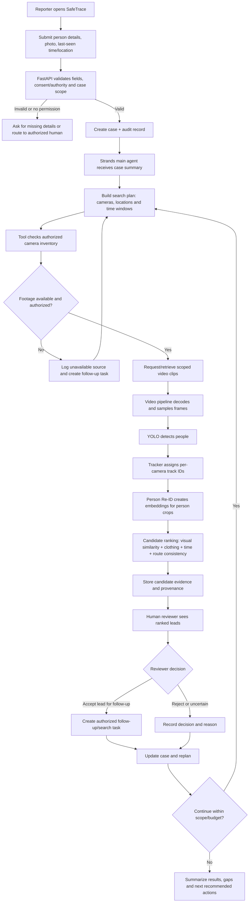

# SafeTrace AI — Technical Flow and Agent Specification

**Version:** MVP design draft  
**Category:** Public safety / societal agent  
**Core design:** One main Strands Agent + deterministic application tools + separate computer-vision pipeline  
**Important:** The system returns *potential sightings for authorized human review*. It must not make an unreviewed identity determination or access cameras without permission.

---

## 1. Product goal

Help authorized responders coordinate a missing-person search by turning a structured report into a traceable search plan, requesting permitted camera footage, searching clips for visually similar candidates, sending leads for human review, and replanning when evidence is missing or a lead is rejected.

SafeTrace is not an emergency-reporting replacement. A user must be directed to the appropriate emergency service immediately when there may be imminent risk. In the UAE, call **999** for police emergencies.

## 2. Recommended technology choices

| Layer | MVP choice | Responsibility |
|---|---|---|
| Frontend | React or Flutter | Report form, case status, evidence review |
| API/backend | Python + FastAPI | Authentication, validation, business rules, API endpoints |
| Agent orchestration | Strands Agents SDK | Plan tool calls, interpret outputs, decide the next permitted step |
| Relational store | PostgreSQL | Cases, users, authorization references, tasks, review decisions, audit trail |
| Evidence storage | S3-compatible object storage (MinIO for local demo) | Encrypted original clips and cropped evidence with retention rules |
| Background jobs | Redis + Celery/RQ | Video processing and long-running search jobs |
| Video processing | FFmpeg + OpenCV | Decode clips, normalize timestamps and sample frames |
| Person detection | Pretrained YOLO person detector | Detect people and produce bounding boxes |
| Per-camera tracking | ByteTrack or BoT-SORT | Maintain temporary IDs inside one video stream |
| Cross-camera candidate retrieval | Pretrained Person Re-ID model, e.g. OpenVINO `person-reidentification-retail-0277` or an evaluated OSNet checkpoint | Convert person crops to visual embeddings and retrieve similar-looking candidates |
| Vector search | FAISS for local MVP; a managed vector index only if needed later | Search reference embeddings against person-crop embeddings |
| Observability | Structured logs + OpenTelemetry or equivalent | Audit agent steps, tool outcomes, latency and failures |

The language model should **not** process every video frame itself. A dedicated vision pipeline should return structured candidates to the agent.

## 3. User input and prerequisites

### Required to open a case

- Case/report ID generated by the backend.
- Reporter identity/contact and authorization status, collected according to policy.
- Missing person's name or case label; do not require a legal name to run the technical demo.
- Recent reference photograph if available.
- Last confirmed sighting: date, time, timezone, location, and how certain it is.
- Description: clothing, approximate age/height/build, distinguishing visible features, mobility needs or other relevant safety information.
- Risk/urgency information for human triage.
- Search scope and permission basis for any camera sources.

### Optional inputs

- Multiple reference photographs from different angles or recent dates.
- Witness description and direction of travel.
- A known route, transport mode, or relevant stop/location.
- Camera clips already lawfully supplied by an authorized source.

### Camera access modes

1. **Competition MVP:** use synthetic cases and pre-approved sample videos.  
2. **Partner pilot:** camera operator or authority provides an authorized clip/API connector and a documented scope.  
3. **Production:** access is limited to approved cameras, case purpose, time window, requesting role and retention policy.

A camera's existence does not imply that SafeTrace is allowed to access it.

## 4. End-to-end workflow



### Detailed steps

1. **Intake:** frontend sends a structured report and photo to FastAPI. The backend validates file type/size, required fields, timestamp/timezone and authorization.
2. **Create case:** assign a case ID, store report metadata, store photo in encrypted object storage, create an audit event and apply retention policy.
3. **Plan search:** agent asks the planning tool for camera locations and time windows. The planning tool uses deterministic constraints and an approved camera map; the model does not invent camera locations.
4. **Check access:** permission service verifies that the case, requesting role, camera source, location and time range are authorized.
5. **Retrieve footage:** request a clip from an approved connector or mark footage unavailable. Record request IDs, source, timestamps and authorization basis.
6. **Prepare reference:** quality-check image, crop the person if possible and create a reference embedding with the same Re-ID model used for video crops.
7. **Process video:** FFmpeg/OpenCV normalizes the clip and timestamps; YOLO detects person boxes; tracker maintains within-camera IDs; Re-ID generates embeddings for person crops.
8. **Rank candidates:** compare embeddings using a validated similarity method; add non-identifying context such as clothing description, timestamp, camera location and plausible route continuity. A similarity score is not a probability of identity.
9. **Create candidate record:** include source/camera ID, source timestamp, clip range, bounding box, visual similarity score, quality warnings, model version, evidence hash and provenance.
10. **Human review:** authorized reviewer inspects the candidate and accepts, rejects or marks uncertain. No candidate should be treated as confirmed solely by the model.
11. **Replan:** accepted leads may justify requesting the next authorized camera/time window; rejected or unavailable leads are logged and the plan is updated.
12. **Close or hand off:** only an authorized human can close the case or confirm that the person has been found. Return a clear summary of searched sources, unavailable footage and unresolved leads.

## 5. Main tools exposed to the Strands agent

Keep the tool list small and specific. All tools should enforce authorization in backend code, independently of what the model asks for.

| Tool | Example input | Output | Guardrail |
|---|---|---|---|
| `get_case_context` | `case_id` | Validated case fields and current state | Only accessible to case-authorized role |
| `validate_search_scope` | `case_id`, `camera_ids`, `start_time`, `end_time` | Scope approval/denial and permitted limits | Mandatory before any retrieval |
| `plan_search_windows` | Last-seen location/time, uncertainty, approved camera catalog | Ordered camera/time windows and rationale | Only use cameras returned from the approved catalog |
| `request_authorized_footage` | `case_id`, `camera_id`, time window, authorization reference | Clip asset ID or pending/unavailable status | No arbitrary URLs or credentials supplied by the LLM |
| `analyze_clip_for_candidates` | `case_id`, `clip_asset_id`, reference-image asset ID, description | Candidate list, crop references, similarity and quality flags | Vision pipeline only; no identity claim |
| `get_connected_search_locations` | Approved camera ID, time window | Adjacent/next locations from approved map | Avoid unsupported route assumptions |
| `create_human_review_task` | Case ID, candidate IDs, evidence IDs, review priority | Task ID and status | Required for consequential lead escalation |
| `record_review_decision` | Candidate ID, accept/reject/uncertain, reviewer ID, reason | Updated candidate status | Reviewer identity required |
| `update_case_and_replan` | Case ID, result event, pending tasks | New search plan or stop recommendation | Stop on scope, time or request budget limits |
| `notify_authorized_contact` | Case ID, approved template, recipient ID | Delivery result | Only approved recipients; no public broadcasting |
| `write_audit_event` | Actor, action, source, result, timestamp | Audit ID | Append-only logs; redact unnecessary PII |

### Important tool-design rule

The agent can choose *which allowed tool to call*. It cannot choose to bypass permissions, query unknown camera feeds, expose raw footage, declare a person definitively identified, or send an unrestricted alert. The API must reject invalid or out-of-scope operations even if the model requests them.

## 6. Suggested system prompt

Use this as the starting system prompt, then enforce the rules in code as well:

```text
You are SafeTrace Search Coordinator, an agent supporting an authorized missing-person search.

MISSION
Coordinate a traceable search workflow using only case-authorized data and tools. Plan the next useful action, call the appropriate tools, inspect their outputs, and replan when new evidence arrives or a step fails.

INPUTS
A validated case record may contain a reference photo, description, last-confirmed location and time, uncertainty, risk context, authorized camera scope, and current task status.

OPERATING RULES
1. Do not delay emergency reporting or urgent human response while collecting extra details.
2. Read the validated case context before taking action.
3. Never invent camera IDs, footage availability, sightings, timestamps, routes, tool results or completed actions.
4. Before every footage request, call validate_search_scope and use only its approved camera IDs, time range and authorization reference.
5. Use plan_search_windows to produce bounded search steps. Do not search outside the approved location/time scope or exceed configured budgets.
6. Use computer-vision outputs only to generate candidate sightings. Similarity scores are not identity probabilities and must not be described as proof.
7. Consider clothing, scene quality, timing and route continuity as supporting context, not conclusive identity evidence. If information conflicts or quality is poor, label the candidate uncertain.
8. Create a human-review task for candidate sightings. Never autonomously accuse, publicly identify, contact unrelated people, dispatch responders, or close a case.
9. If footage is unavailable, record that result, create a follow-up where appropriate, and replan within the approved scope. Never imply a camera was searched if no clip was obtained and processed.
10. Minimize personal data. Do not expose raw video or unnecessary identity details in general notifications.
11. Every meaningful step must have an auditable tool result. Report actions as completed only when the tool confirms completion.
12. Stop and ask for authorized human intervention when permission is missing, a request exceeds scope, tools disagree, risk is unclear, or the configured search budget is exhausted.

OUTPUT
Return a concise case status with: actions completed, footage requested/processed/unavailable, candidate leads for human review, confidence limitations, pending tasks, and recommended next action. Clearly separate facts returned by tools from your own proposed next steps.
```

## 7. Candidate scoring and vision approach

### MVP vision pipeline

1. Reference photo: quality check and person crop, if detection is possible.
2. For each frame: YOLO person detection.
3. Within each camera: ByteTrack or BoT-SORT for temporary track IDs.
4. For each suitable crop: pretrained Person Re-ID model creates an embedding.
5. Similarity search: compare the reference embedding with crop embeddings; retrieve top-k candidates.
6. Context ranking: apply configurable weights to visual similarity, clothing consistency, timestamp window, image quality and plausible camera-to-camera continuity.
7. Human review: show short clips, not just the top score.

Do not choose a universal similarity threshold by intuition. Calibrate it on held-out videos from the target cameras and select a threshold based on false-match cost and recall. Include an “insufficient evidence” outcome.

### Model references

- Strands Python quickstart: https://strandsagents.com/docs/user-guide/sdk/quickstart/python/
- Strands agent anatomy/system prompt/tools: https://strandsagents.com/docs/user-guide/sdk/agents/
- Ultralytics tracking: https://docs.ultralytics.com/modes/track
- OpenVINO person Re-ID model: https://docs.openvino.ai/2023.3/omz_models_model_person_reidentification_retail_0277.html
- Open Model Zoo model repo: https://github.com/openvinotoolkit/open_model_zoo/tree/master/models/intel/person-reidentification-retail-0277

A pretrained model can support the initial prototype without person-specific training, but real-CCTV accuracy must be evaluated. Appearance matching may fail when clothing changes, the body is occluded, camera angle differs, or video quality is poor.

## 8. API endpoints (suggested)

- `POST /api/cases` — create validated case.
- `POST /api/cases/{case_id}/reference-photo` — upload photo and return asset ID.
- `POST /api/cases/{case_id}/search-runs` — request a bounded search run.
- `GET /api/cases/{case_id}/status` — report task/case status.
- `GET /api/cases/{case_id}/candidates` — get reviewed/unreviewed candidate metadata (role gated).
- `POST /api/candidates/{candidate_id}/review` — authorized reviewer accepts/rejects/marks uncertain.
- `GET /api/cases/{case_id}/audit` — accessible audit events for authorized users.

Use background jobs for video processing. The HTTP request should return a run ID rather than waiting for every clip to finish.

## 9. Suggested data entities

- `Case`: case ID, status, last-seen location/time/uncertainty, risk flags, scope, retention deadline.
- `PersonReference`: encrypted photo asset ID, description, quality flags, consent/authorization metadata.
- `CameraSource`: source ID, owner/partner, permitted locations, access method, retention and availability metadata.
- `FootageRequest`: camera ID, case ID, requested time range, authorization reference, request state, clip asset ID.
- `CandidateSight`: case ID, source ID, clip/time, bounding box, temporary track ID, similarity and quality metrics, model version, evidence hash, review status.
- `Task`: task type, owner/role, due time, dependencies, state, result.
- `AuditEvent`: actor, action, timestamp, input/output references, decision and outcome.

Store raw video separately from metadata. Encrypt sensitive assets, apply short retention, log every access, and restrict who can view clips or candidate sightings.

## 10. Human review and privacy requirements

- Use only synthetic/pre-approved clips in the competition demo.
- Production CCTV connectors require formal authorization, purpose limits and source-owner agreements.
- No public-facing identity claims; no automated face recognition unless separately approved by the relevant authorities and counsel.
- Human review is mandatory before treating any sighting as a lead for operational action.
- Never expose live location information to the public or unauthorized reporters.
- Apply role-based access, audit logs, encryption, deletion/retention rules and incident response.
- If the system cannot access footage, say so clearly; do not imply that the search succeeded.
- Provide an explicit emergency guidance path and never delay direct emergency contact.

## 11. MVP acceptance tests

1. Valid synthetic case creates a case ID and audit events.
2. Invalid/missing timestamp or location is flagged for correction, without blocking urgent human escalation.
3. An unauthorized camera request is rejected by backend policy even if requested by the agent.
4. A valid sample clip produces detections and candidate records with camera/time provenance.
5. A similar-looking but incorrect person can be rejected by human review and is not reported as found.
6. Unavailable footage produces a recorded exception and a revised plan.
7. A lead accepted by the reviewer can trigger a follow-up task only through an authorized workflow.
8. All agent tool calls, results, approvals and failures are traceable.
9. Search ends when the approved scope, time window or tool-call budget is exhausted.
10. Report precision/recall at a chosen operating threshold, false candidate rate, processing time, footage availability and successful task completion on a held-out test set.

## 12. MVP build order

1. Build the case form, FastAPI endpoints, PostgreSQL schema and authorization gates.
2. Build the vision worker for pre-approved sample videos: YOLO + tracker + pretrained Re-ID + candidate viewer.
3. Add the bounded Strands agent and only the first four tools: get case, validate scope, plan search, analyze authorized sample clip.
4. Add candidate review and audit log.
5. Add simulated camera-connector failures and the replan loop.
6. Evaluate on held-out sample clips; tune ranking/thresholds and document limitations.
7. Only after partner authorization, prototype a real camera connector.

**Success criterion:** SafeTrace does not need to claim that it identifies a person autonomously. Its demo should prove that it plans a bounded search, uses authorized video tools, produces evidence-backed candidate leads, learns from human review, and selects a sensible next action when the first lead fails.
