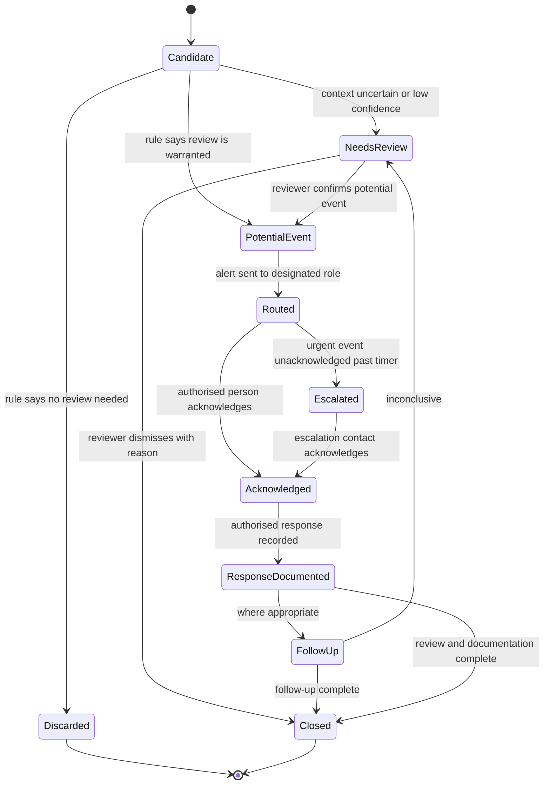
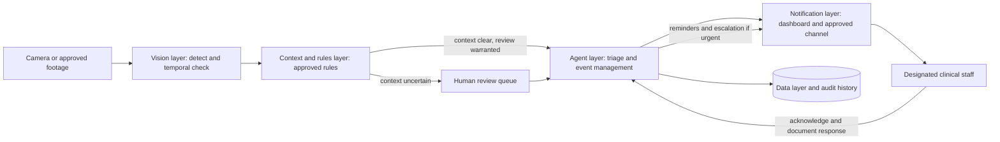

# CareGuard AI — Requirements Document

| | |
|---|---|
| **Product** | CareGuard AI — Hospital Safety and Response Agent |
| **Document type** | Product / System Requirements Specification |
| **Version** | 0.1 (Draft) |
| **Date** | 22 October 2026 |
| **Status** | For review |
| **Source** | CareGuard AI project brief |

---

## Table of Contents

1. [Purpose and Scope](#1-purpose-and-scope)
2. [Background and Problem Statement](#2-background-and-problem-statement)
3. [Stakeholders and User Roles](#3-stakeholders-and-user-roles)
4. [Assumptions, Constraints and Dependencies](#4-assumptions-constraints-and-dependencies)
5. [Product Concept and Workflow](#5-product-concept-and-workflow)
6. [Use Cases and Scenarios](#6-use-cases-and-scenarios)
7. [Functional Requirements](#7-functional-requirements)
8. [Non-Functional Requirements](#8-non-functional-requirements)
9. [Data Requirements](#9-data-requirements)
10. [System Architecture](#10-system-architecture)
11. [Safety, Privacy, Ethics and Compliance](#11-safety-privacy-ethics-and-compliance)
12. [MVP Scope and Development Plan](#12-mvp-scope-and-development-plan)
13. [Evaluation Plan and Success Metrics](#13-evaluation-plan-and-success-metrics)
14. [Demonstration Requirements](#14-demonstration-requirements)
15. [Differentiation Validation Plan](#15-differentiation-validation-plan)
16. [Risks and Mitigations](#16-risks-and-mitigations)
17. [Open Questions](#17-open-questions)
18. [Acceptance Criteria](#18-acceptance-criteria)
19. [Traceability: Phases to Requirements](#19-traceability-phases-to-requirements)
20. [Glossary](#20-glossary)

---

## 1. Purpose and Scope

### 1.1 Purpose

This document defines the requirements for **CareGuard AI**, an AI agent that identifies a narrowly defined potential hospital safety event, checks the relevant context, alerts the responsible clinical staff, tracks acknowledgement, and records the response.

The core concept is to connect **computer vision** with **context-aware rules** and an **accountable response workflow**. The system supports clinical teams by routing potential events and documenting follow-up. It does not replace clinical judgement.

### 1.2 Scope

**In scope**

- Camera-based detection of one narrowly defined potential safety event (see Section 6.2 for the MVP scenario)
- Explicitly approved, configurable safety rules that use location and activity context
- Uncertainty handling, with human review when context cannot be inferred reliably
- Event creation with minimal evidence, confidence score, zone, and timestamp
- Role-based alert routing, acknowledgement tracking, and follow-up reminders
- Escalation of urgent unacknowledged events under the approved procedure
- Authorised response documentation and closure with a recorded reason
- Audit history and audit summaries
- Evaluation, including privacy, workflow disruption and alarm-fatigue assessment

**Out of scope**

- Diagnosing a patient or directing treatment
- Declaring a patient or area safe based on video alone
- Automatically closing uncertain or high-impact events
- Use of real patient footage without the required authorisation
- Live clinical deployment without hospital approval, clinical validation, privacy/legal review, and medical-device assessment
- More than one detection scenario in the first MVP
- Replacing clinical staff, existing alarm systems, or established emergency procedures

### 1.3 Target Users

- Hospital safety teams
- Infection-prevention teams
- Ward supervisors
- Clinical operations managers

---

## 2. Background and Problem Statement

Hospitals are complex environments where safety requirements depend on the task, location, patient condition, and clinical protocol. For example, gloves are required for certain clinical activities but not for every interaction.

A simplistic camera system may:

- generate incorrect alerts,
- interrupt clinical care, or
- expose sensitive patient information.

The system must therefore do more than identify an object or person. It shall:

1. Apply **explicitly approved** rules.
2. **Communicate uncertainty** instead of asserting a violation.
3. **Route** potential events to qualified staff.
4. **Record** who responded and what was decided.

> **Important:** Hospital PPE monitoring, fall detection, and patient-monitoring products already exist. The project must validate a specific unmet need before claiming originality. See [Section 15](#15-differentiation-validation-plan).

---

## 3. Stakeholders and User Roles

### 3.1 Roles

| Role | Description | Primary needs |
|---|---|---|
| **Ward / Clinical Supervisor** | Designated recipient of alerts for a zone | Receive relevant alerts, acknowledge, decide response |
| **Infection-Prevention Reviewer** | Reviews potential infection-control events | Review uncertain and PPE-related events, document response |
| **Hospital Safety Officer** | Owns safety program and rules | Approve rules, review events, audit, evaluate |
| **Clinical Operations Manager** | Oversees operations | Aggregate reports, workflow and disruption insight |
| **Privacy / Compliance Officer** | Oversees data protection | Review data handling, retention, access logs |
| **System Administrator** | Maintains the platform | Camera setup, health monitoring, configuration |
| **Agent (system actor)** | The automated CareGuard workflow | Detect, check context, route, track, remind, log |

### 3.2 Permission Summary

| Capability | Ward Supervisor | IPC Reviewer | Safety Officer | Ops Manager | Privacy Officer | System Admin |
|---|:---:|:---:|:---:|:---:|:---:|:---:|
| Receive alerts for assigned zones | ✔ | ✔ | ✔ | — | — | — |
| Acknowledge alerts | ✔ | ✔ | ✔ | — | — | — |
| Document response and close events | ✔ (authorised) | ✔ | ✔ | — | — | — |
| Review uncertain events | — | ✔ | ✔ | — | — | — |
| Create and approve rules | — | ✔ (propose) | ✔ (approve) | — | — | — |
| View minimal evidence | ✔ (assigned) | ✔ | ✔ | — | ✔ (audit) | — |
| View aggregate metrics | — | ✔ | ✔ | ✔ | ✔ | — |
| View audit history | — | — | ✔ | ✔ (read) | ✔ | ✔ |
| Configure cameras, retention, access | — | — | — | — | ✔ (retention) | ✔ |

---

## 4. Assumptions, Constraints and Dependencies

### 4.1 Assumptions

- **A1.** The MVP uses a USB webcam in a staged or approved environment, with consenting participants or synthetic footage.
- **A2.** One narrow scenario is selected for the first MVP. This document assumes the **potential PPE compliance issue** scenario (see OQ-1).
- **A3.** The safety rule for the scenario is defined and approved by a person with clinical or infection-prevention authority.
- **A4.** Location and activity context come from configuration or other approved inputs. The system does not infer clinical activity or patient condition from video alone.
- **A5.** In the prototype, hospital communication channels and clinical roles are simulated.
- **A6.** The prototype does not need patient identifiers.

### 4.2 Constraints

- **C1.** The agent shall not diagnose a patient, direct treatment, or declare a patient safe based on video alone.
- **C2.** The absence of a detected event shall not be equated with patient safety.
- **C3.** Uncertain or high-impact events shall not be closed automatically.
- **C4.** Patient footage shall not be used without the required authorisation.
- **C5.** Staged or synthetic footage is preferred for the competition MVP.
- **C6.** Collection and storage of identifiable information shall be minimised.
- **C7.** Clinical staff retain responsibility for clinical judgement and patient care.
- **C8.** A fallback process shall exist for camera, network, model, and notification failures.
- **C9.** Any live clinical deployment requires hospital approval, clinical validation, privacy/legal review, and assessment of applicable medical-device requirements.

### 4.3 Dependencies

| Dependency | Needed for |
|---|---|
| Python runtime and OpenCV | Frame capture and processing |
| Vision model validated for the selected scenario | Detection layer |
| Approved rule definitions from a clinical or IPC authority | Context and rules layer |
| Consent process for staged scenarios, or synthetic footage | Phase 1 |
| Simulated or approved communication channel | Notification layer |
| Clinical safety professionals for interviews and review | Differentiation research and reviewer agreement |

---

## 5. Product Concept and Workflow

### 5.1 Agent Workflow

**Observe → Detect → Check Context → Flag Potential Event → Route to Staff → Acknowledge → Human Response → Document → Verify Where Appropriate → Close or Escalate**

### 5.2 Event Lifecycle

### 5.3 State Definitions

| State | Meaning |
|---|---|
| **Candidate** | Raw detection that has not yet been checked against context rules |
| **Discarded** | Rule determined no review is needed; logged without alerting staff |
| **NeedsReview** | Context is uncertain or confidence is low; waiting for human review. Never auto-closed |
| **PotentialEvent** | Rule indicates the condition warrants review; event is created |
| **Routed** | Alert sent to the designated clinical role |
| **Escalated** | Urgent event stayed unacknowledged; escalated per hospital policy |
| **Acknowledged** | An authorised person has accepted the alert |
| **ResponseDocumented** | An authorised person has recorded the action taken |
| **FollowUp** | Optional check or reminder step where appropriate |
| **Closed** | Final state with required review and documentation complete and a closure reason |

### 5.4 Closure Reasons

`ReviewedAndAddressed` · `ReviewedNoActionRequired` · `DismissedFalsePositive` · `DismissedContextNotApplicable` · `Duplicate` · `Other (with note)`

---

## 6. Use Cases and Scenarios

### 6.1 Scenario Overview

| ID | Scenario | MVP status |
|---|---|---|
| UC-01 | Potential PPE compliance issue | **Assumed MVP scenario** (confirm via OQ-1) |
| UC-02 | Potential patient fall | Post-MVP candidate |
| UC-03 | Restricted-area entry | Post-MVP candidate |
| UC-04 | Clinical safety follow-up | Supports all scenarios; core to the response workflow |
| UC-05 | Ambiguous case sent to review | Must (demonstration step 7) |

The first MVP shall implement **one** scenario only.

### 6.2 UC-01 Potential PPE Compliance Issue (assumed MVP scenario)

| | |
|---|---|
| **Actors** | Agent, Ward/Clinical Supervisor or IPC team, authorised reviewer |
| **Trigger** | The vision model identifies a possible PPE issue |
| **Preconditions** | Zone and rule configured and approved; designated role assigned; staged or approved footage in use |

**Main flow**

1. A webcam observes a staged or approved clinical environment.
2. The vision model identifies a possible PPE issue.
3. The rules engine checks whether the relevant PPE is required for the configured activity and location.
4. If the context is uncertain, the agent requests human review and does not assert a violation.
5. For a validated potential issue, the agent creates an event with a timestamp, zone, confidence, and minimal evidence.
6. The system routes the alert to the designated clinical supervisor or infection-prevention team.
7. An authorised person acknowledges the alert and decides the appropriate response.
8. The agent records the response and follows the approved escalation procedure if an urgent event remains unacknowledged.
9. The event closes only when the required review and documentation are complete.

**Alternate flows**

- *PPE not required for configured activity and location:* no event raised; candidate discarded and logged.
- *Context unavailable or ambiguous:* routed to human review.
- *Alert unacknowledged:* reminders sent; urgent events escalate under approved policy.
- *Reviewer disagrees with the detection:* event dismissed with a reason; feedback stored for evaluation.

### 6.3 UC-02 Potential Patient Fall (post-MVP candidate)

Flag a possible fall for prompt human assessment. The system shall not infer the patient's medical condition or assume that a person is safe because no fall was detected.

### 6.4 UC-03 Restricted-Area Entry (post-MVP candidate)

Detect entry into a configured restricted area and notify the responsible staff member.

### 6.5 UC-04 Clinical Safety Follow-Up

Track whether a potential safety event was acknowledged and whether an authorised staff member documented the response.

### 6.6 UC-05 Ambiguous Case

When context cannot be inferred reliably or confidence is low, the system routes the case to human review. It does not trigger an automatic decision or an assertion of violation.

### 6.7 Scenario Selection Guidance

The brief requires only one scenario for the first MVP. The table below is a recommendation to support that decision.

| Criterion | PPE issue | Patient fall | Restricted-area entry |
|---|---|---|---|
| Ease of staging with consenting participants | High | Medium; staging a fall needs care | High |
| Involves patients in footage | Can be avoided | Likely | Can be avoided |
| Consequence of a missed or late alert | Moderate | High | Low to moderate |
| Dependence on clinical context rules | High (shows context-aware value) | Low | Low |
| Fit with the project's research question (context-aware rules) | Strong | Weak | Weak |

---

## 7. Functional Requirements

**Priority key (MoSCoW):** **M** = Must · **S** = Should · **C** = Could.
**Phase** refers to the MVP plan in [Section 12](#12-mvp-scope-and-development-plan). "Post" means after the MVP.

### 7.1 Camera Layer (CAM)

| ID | Requirement | Pri | Phase |
|---|---|:---:|:---:|
| CAM-01 | The system shall read frames from a USB webcam using OpenCV. | M | 2 |
| CAM-02 | The system shall accept approved recorded footage or synthetic video as an input source. | M | 2 |
| CAM-03 | Each camera shall have a unique identifier and be associated with one or more zones. | M | 2 |
| CAM-04 | Camera input shall sit behind a common interface so later hospital camera integration does not change downstream components. | S | 2 |
| CAM-05 | Hospital camera integration shall be enabled only after documented approval. | M | Post |
| CAM-06 | The system shall detect lost, frozen or degraded streams and trigger the fallback procedure (see FBK requirements). | M | 4 |

### 7.2 Computer Vision (DET)

| ID | Requirement | Pri | Phase |
|---|---|:---:|:---:|
| DET-01 | The system shall use a vision model validated for the selected scenario. | M | 2 |
| DET-02 | The system shall implement one narrow detection task for the MVP scenario. | M | 2 |
| DET-03 | Every detection shall carry a confidence score. | M | 2 |
| DET-04 | The system shall support configurable zones. | M | 3 |
| DET-05 | The system shall apply temporal checks so a condition must persist for a configurable duration before becoming a candidate, to reduce single-frame false alarms. | M | 3 |
| DET-06 | The detection model shall sit behind an interface so it can be replaced or retrained without changing the rules or agent layers. | S | 2 |
| DET-07 | The system shall record the model name and version with each event. | S | 3 |
| DET-08 | The system shall not perform facial recognition or identify individuals. | M | 2 |

### 7.3 Context and Rules (CTX)

| ID | Requirement | Pri | Phase |
|---|---|:---:|:---:|
| CTX-01 | Safety rules shall be explicitly configured. The system shall not apply any rule that has not been approved. | M | 3 |
| CTX-02 | Each rule shall define the observed condition, the location or zone, the relevant activity context, the confidence thresholds, the uncertainty handling, and whether human review is required. | M | 3 |
| CTX-03 | The rules engine shall determine whether the observed condition warrants review for the configured activity and location. | M | 3 |
| CTX-04 | Location and activity context shall be taken from configuration or other approved inputs. The system shall not infer clinical activity, patient condition, or clinical need from video alone. | M | 3 |
| CTX-05 | When context is unavailable, ambiguous, or cannot be inferred reliably, the system shall route the candidate to human review and shall not assert a violation. | M | 3 |
| CTX-06 | Rules shall carry approval metadata: approver, role, date, and version. | M | 3 |
| CTX-07 | Rule changes shall go through an approval step and be written to the audit history. | S | 3 |
| CTX-08 | Two confidence thresholds shall be supported: *potential event* and *needs review*. Values between them shall be routed to human review. | M | 3 |
| CTX-09 | Rules may define an urgency level used for routing and escalation. | S | 4 |

### 7.4 Event Management (EVT)

| ID | Requirement | Pri | Phase |
|---|---|:---:|:---:|
| EVT-01 | For a validated potential event, the agent shall create an event containing: event ID, timestamp, event category, zone, confidence, review status, and minimal evidence. | M | 3 |
| EVT-02 | Evidence shall be **minimal**: only what a reviewer needs to assess the event (see PRV requirements). | M | 3 |
| EVT-03 | Events shall move only through the lifecycle states in Section 5.2, and every transition shall be logged with time and actor. | M | 5 |
| EVT-04 | The system shall suppress duplicate events for the same ongoing condition using a cooldown or merge rule. | M | 3 |
| EVT-05 | The agent shall triage events by category, urgency, confidence, and context. | S | 4 |
| EVT-06 | Each event shall record the rule, rule version, and context used, so reviewers can see why it was raised. | M | 3 |
| EVT-07 | The event shall not state or imply a violation when its status is *NeedsReview*. It shall be labelled as a possible issue awaiting review. | M | 3 |

### 7.5 Routing and Notification (RTE)

| ID | Requirement | Pri | Phase |
|---|---|:---:|:---:|
| RTE-01 | The system shall route each alert to the designated clinical supervisor or infection-prevention team according to role and zone. | M | 4 |
| RTE-02 | Routing shall be role-based, with a primary and an alternate recipient per role. | M | 4 |
| RTE-03 | The prototype shall provide a dashboard channel and a simulated clinical-role notification. | M | 4 |
| RTE-04 | Production notifications shall use only the hospital's approved communication channel. | M | Post |
| RTE-05 | Alert content shall include event category, zone, time, confidence, review status, and a link to the minimal evidence and an acknowledge action. Alerts shall not include more identifiable information than needed. | M | 4 |
| RTE-06 | The system shall record delivery status per channel (sent, delivered, failed). | M | 4 |
| RTE-07 | On delivery failure the system shall retry or use an alternate approved channel and notify an administrator. | S | 4 |
| RTE-08 | Alert delivery shall avoid disrupting care. By default there shall be no audible alarm in patient areas; audible alerts, if any, shall be enabled only per approved policy. | M | 4 |

### 7.6 Acknowledgement and Response (ACK)

| ID | Requirement | Pri | Phase |
|---|---|:---:|:---:|
| ACK-01 | Only authorised users shall be able to acknowledge an alert. | M | 5 |
| ACK-02 | The system shall record who acknowledged and when. | M | 5 |
| ACK-03 | An authorised person shall decide the appropriate response. The system shall not decide or recommend clinical treatment. | M | 5 |
| ACK-04 | An authorised reviewer shall document the response using a structured category and free-text notes. Notes shall not require patient identifiers. | M | 5 |
| ACK-05 | The agent shall record the response and link it to the event. | M | 5 |
| ACK-06 | Acknowledgement alone shall not close an event. | M | 5 |
| ACK-07 | A reviewer shall be able to dismiss an event as a false positive, or as not applicable in context, with a reason. This feedback shall be stored for evaluation. | M | 5 |
| ACK-08 | A reviewer shall be able to reassign an event to another authorised role. | C | Post |

### 7.7 Reminders and Escalation (ESC)

| ID | Requirement | Pri | Phase |
|---|---|:---:|:---:|
| ESC-01 | The agent shall send follow-up reminders for events that remain unacknowledged, at intervals set by urgency. | S | 5 |
| ESC-02 | For urgent events that remain unacknowledged, the agent shall escalate according to the hospital's approved escalation procedure. | M | 5 |
| ESC-03 | Escalation steps, contacts, and timings shall be configurable, versioned, and limited to designated clinical staff. | M | 5 |
| ESC-04 | Every reminder and escalation shall be recorded with time, recipient, and delivery status. | M | 5 |
| ESC-05 | Escalation shall be limited to notification of designated clinical staff. It shall not trigger disciplinary actions or automated clinical actions. | M | 5 |

### 7.8 Closure and Follow-Up (CLS)

| ID | Requirement | Pri | Phase |
|---|---|:---:|:---:|
| CLS-01 | An event shall close only when the required review and documentation are complete. | M | 5 |
| CLS-02 | Every closure shall record a closure reason and the closing user. | M | 5 |
| CLS-03 | The system shall not automatically close uncertain events or high-impact events. | M | 5 |
| CLS-04 | Where appropriate for the scenario, the agent may run a follow-up check. Its result shall be presented to a reviewer and shall not by itself establish that a patient or area is safe. | S | 5 |
| CLS-05 | Authorised users shall be able to reopen a closed event with a recorded reason. | S | Post |

### 7.9 Audit (AUD)

| ID | Requirement | Pri | Phase |
|---|---|:---:|:---:|
| AUD-01 | The system shall keep an append-only audit history of candidates, event creation, rule evaluations, state changes, alerts, acknowledgements, reviews, responses, reminders, escalations, closures, rule changes, and data access. | M | 5 |
| AUD-02 | Each entry shall record timestamp, actor (user or agent), action, and related event or configuration ID. | M | 5 |
| AUD-03 | The agent shall generate an audit summary per event. Generated summaries shall be labelled as such and link to the underlying audit entries. | S | 5 |
| AUD-04 | Audit history shall record who viewed evidence. | S | 5 |

### 7.10 Safety Guardrails (SAF)

| ID | Requirement | Pri | Phase |
|---|---|:---:|:---:|
| SAF-01 | The system shall not diagnose a patient, direct treatment, or make autonomous treatment decisions. | M | All |
| SAF-02 | The system shall not declare a patient safe based on video alone. | M | All |
| SAF-03 | The user interface shall not present the absence of a detected event as evidence of patient safety. Where status is shown, it shall indicate the limits of monitoring. | M | 4 |
| SAF-04 | The system shall communicate uncertainty explicitly and shall request human review where context or confidence is insufficient. | M | 3 |
| SAF-05 | Outputs shall not be used for automated individual performance evaluation or disciplinary decisions. | M | All |
| SAF-06 | The system shall clearly show users which detection scenario is in scope and which hazards are not monitored. | S | 4 |

### 7.11 Fallback and Failure Handling (FBK)

| ID | Requirement | Pri | Phase |
|---|---|:---:|:---:|
| FBK-01 | The system shall detect camera, network, model, and notification failures and show a visible degraded status to administrators and designated staff. | M | 4 |
| FBK-02 | On failure, the system shall notify the designated administrator and direct staff to the documented fallback process. | M | 4 |
| FBK-03 | A documented manual fallback process shall exist before any clinical trial or deployment. | M | Post |
| FBK-04 | Events and states shall survive application restarts. | M | 5 |
| FBK-05 | A failed component shall not cause the system to display "all clear". | M | 4 |

### 7.12 Dashboard (DSH)

| ID | Requirement | Pri | Phase |
|---|---|:---:|:---:|
| DSH-01 | The dashboard shall list events with category, zone, time, confidence, review status, urgency, and alert/acknowledgement status, with filtering. | M | 4 |
| DSH-02 | The event detail view shall show minimal evidence, rule and context used, alert history, acknowledgement, response record, closure reason, and audit history. | M | 5 |
| DSH-03 | The dashboard shall provide a review queue for uncertain cases with confirm, dismiss, and close actions. | M | 3 |
| DSH-04 | Authorised users shall be able to view and manage rules, zones, and routing through the interface or configuration files. | M | 3 |
| DSH-05 | The dashboard shall show the evaluation metrics in Section 13 for authorised roles. | S | 6 |
| DSH-06 | Access shall be role-based as described in Section 3.2. | M | 4 |

---

## 8. Non-Functional Requirements

> Numeric targets below are **proposed starting values**. They must be baselined during Phases 2 and 6 and confirmed with clinical safety stakeholders.

### 8.1 Performance

| ID | Requirement | Proposed target |
|---|---|---|
| NFR-P1 | Time from a validated potential event to dashboard alert | ≤ 10 seconds |
| NFR-P2 | Time from urgent event to escalation contact after timer expiry | ≤ 10 seconds |
| NFR-P3 | Frame-processing rate sufficient for temporal checks on prototype hardware | Baseline in Phase 2 |
| NFR-P4 | Dashboard refresh for new events | ≤ 3 seconds |

### 8.2 Accuracy and Quality

| ID | Requirement |
|---|---|
| NFR-A1 | Precision, recall, false alarms per hour, and missed-event rate shall be measured on annotated test footage and reported. |
| NFR-A2 | Thresholds shall be tunable per zone and rule to balance missed events against alarm fatigue. |
| NFR-A3 | The test set shall include varied lighting, camera angles, occlusion, different PPE types and colours, different body sizes and skin tones, and ambiguous situations. |
| NFR-A4 | Reviewer agreement on alert appropriateness shall be measured using at least two independent reviewers. |
| NFR-A5 | Known limitations shall be documented and visible to users. |

### 8.3 Reliability

| ID | Requirement |
|---|---|
| NFR-R1 | Open events, states, reminders, and escalation timers shall persist across restarts. |
| NFR-R2 | Failure of one camera shall not stop processing of others. |
| NFR-R3 | Notifications that cannot be sent immediately shall be queued and retried. |
| NFR-R4 | Component failures shall be surfaced to administrators (see FBK-01). |

### 8.4 Security

| ID | Requirement |
|---|---|
| NFR-S1 | Users shall authenticate, and access shall be controlled by role. |
| NFR-S2 | Data shall be encrypted in transit and at rest. |
| NFR-S3 | Credentials and keys shall be stored as secrets, not in source code. |
| NFR-S4 | Access to evidence and records shall be logged. |
| NFR-S5 | Audit history shall be append-only or tamper-evident. |
| NFR-S6 | Strict access controls shall limit evidence visibility to assigned and authorised roles. |

### 8.5 Usability and Workflow Fit

| ID | Requirement | Proposed target |
|---|---|---|
| NFR-U1 | Acknowledging an alert shall take few steps from the notification. | ≤ 2 steps |
| NFR-U2 | Alerts shall be concise and understandable without technical knowledge of the model. | — |
| NFR-U3 | The workflow shall not add unacceptable disruption to clinical activity, as judged in the Phase 7 safety review. | Defined in review |
| NFR-U4 | Alert volume shall be monitored so alarm fatigue can be assessed. | — |

### 8.6 Explainability and Transparency

| ID | Requirement |
|---|---|
| NFR-X1 | For each event the system shall show the rule applied, context used, confidence, and review status. |
| NFR-X2 | Uncertain results shall be labelled as uncertain and never presented as confirmed violations. |
| NFR-X3 | Closed status shall not be presented as a guarantee of safety. |

### 8.7 Maintainability and Testability

| ID | Requirement |
|---|---|
| NFR-M1 | Detection model, camera source, rules, and notification channel shall be modular and replaceable. |
| NFR-M2 | Rules, zones, routing, and escalation shall be stored as data, not hard-coded. |
| NFR-M3 | The system shall replay approved or synthetic footage for repeatable testing. |
| NFR-M4 | Rules, state machine, reminders, and escalation logic shall have automated tests. |

### 8.8 Portability

| ID | Requirement |
|---|---|
| NFR-T1 | The prototype shall run on a single laptop or desktop with a USB webcam. |
| NFR-T2 | The design shall not prevent later integration with hospital cameras and communication channels, subject to approval. |

---

## 9. Data Requirements

### 9.1 Principle

Store **only necessary information**. The MVP shall not require patient names, identifiers, or clinical records.

### 9.2 Core Entities

| Entity | Key fields |
|---|---|
| **Camera** | camera_id, source type (webcam / file / synthetic), status, assigned zones |
| **Zone** | zone_id, camera_id, geometry, zone type, responsible role |
| **Rule** | rule_id, scenario, observed condition, zone/location, activity context, thresholds, uncertainty handling, human-review flag, urgency, approver, approval date, version, active flag |
| **ContextRecord** | event or candidate ID, context source, activity, location, availability flag |
| **Event** | event_id, timestamp, category, zone, confidence, review status, urgency, state, rule ID and version, model version, evidence reference, closure reason |
| **Review** | event_id, reviewer, time, decision (confirm / dismiss), reason |
| **Alert** | alert_id, event_id, recipient role and user, channel, sent time, delivery status |
| **Acknowledgement** | event_id, user, time |
| **ResponseRecord** | event_id, authorised user, response category, notes, time |
| **EscalationPolicy** | policy_id, steps, timers, designated contacts, version |
| **AuditEntry** | entry_id, timestamp, actor, action, target ID, details |
| **User** | user_id, name, role, contact, status |

### 9.3 Minimum Event Record

Each event shall store at least:

- Event ID and timestamp
- Event category and zone
- Confidence and review status
- Alert and acknowledgement status
- Authorised response record
- Closure reason and audit history

### 9.4 Evidence

| Item | Requirement |
|---|---|
| Evidence type | Minimal: for example a single cropped or de-identified snapshot, or a short clip, only as needed for review |
| De-identification | Faces and other identifying features blurred or cropped where practical (proposed; see OQ-5) |
| Continuous video | Not stored by default |
| Patient identity | Not captured as a data field |
| Access | Assigned and authorised roles only; every view logged |

### 9.5 Retention

| Data | Retention |
|---|---|
| Evidence | Shortest period that supports review and evaluation; to be set with privacy/legal review |
| Event records | To be set by hospital policy |
| Audit history | To be set by hospital policy; retained at least as long as the event records |
| Staged-scenario footage | Deleted or archived according to participant consent terms |

---

## 10. System Architecture

### 10.1 Layers

| Layer | Responsibilities | Notes |
|---|---|---|
| **Camera layer** | Frame capture from webcam, approved recorded footage, staged scenarios; hospital cameras only after approval | USB webcam, OpenCV |
| **Computer vision layer** | Detect the selected condition; configurable zones; temporal checks | Python, OpenCV, validated model |
| **Context and rules layer** | Approved rules, location and activity context, confidence thresholds, uncertainty handling, human-review requirements | Rule store with approval metadata |
| **Agent layer** | Event triage, role-based alert routing, acknowledgement tracking, follow-up reminders, response logging, audit summaries | State machine / workflow engine |
| **Notification layer** | Prototype dashboard, approved hospital communication channel, escalation to designated clinical staff per policy | Simulated in prototype |
| **Data layer** | Minimal event data, access-controlled evidence, audit history | Encryption, retention limits |

### 10.2 Data Flow

### 10.3 Design Principles

1. **Human responsibility:** clinical staff make clinical judgements and decide responses.
2. **Context before alert:** apply an approved rule before flagging.
3. **Uncertainty is explicit:** unclear cases go to review, not to automatic decisions.
4. **Minimal data:** collect and keep the least identifiable information needed.
5. **Accountable workflow:** every alert has an owner, an acknowledgement, a documented response, and an audit trail.
6. **Safe failure:** no failure mode shall look like "all clear".

---

## 11. Safety, Privacy, Ethics and Compliance

### 11.1 Safety Limitations (must be visible to users)

- The system must not diagnose a patient, direct treatment, or make autonomous treatment decisions.
- The absence of a detected event does not mean a patient or area is safe.
- Uncertain or high-impact events are never closed automatically.
- Camera-based detection can miss events or raise false alarms.
- The system is not a replacement for clinical judgement, bedside observation, existing alarm systems, or emergency procedures.

### 11.2 Privacy Requirements

| ID | Requirement |
|---|---|
| PRV-01 | Patient footage shall not be used without the required authorisation. |
| PRV-02 | The competition MVP shall use staged scenarios with consenting participants, or synthetic footage. |
| PRV-03 | Participants in staged scenarios shall give documented consent covering recording, use, storage, and deletion. |
| PRV-04 | The system shall collect and store the minimum identifiable information needed. |
| PRV-05 | Facial recognition shall not be used. |
| PRV-06 | Evidence shall be minimal and, where practical, de-identified. |
| PRV-07 | Data shall be encrypted in transit and at rest, with strict access controls and retention limits. |
| PRV-08 | Access to evidence shall be limited to assigned and authorised roles, and every access shall be logged. |
| PRV-09 | A privacy review shall be completed before any use beyond staged or synthetic data. |

### 11.3 Compliance and Clinical Governance

- Any live clinical deployment requires **hospital approval**, **clinical validation**, **privacy and legal review**, and **assessment of applicable medical-device requirements**.
- Rules shall be approved by an authorised clinical or infection-prevention owner before activation.
- The project shall not claim clinical effectiveness, regulatory clearance, or compliance without formal assessment.
- The project shall identify and document the health-data, privacy, and workplace-monitoring requirements that apply to the intended setting before use beyond the prototype.

### 11.4 Fallback

A documented fallback process shall cover camera, network, model, and notification failure. Staff shall be told how to continue standard safety practice when the system is degraded.

---

## 12. MVP Scope and Development Plan

### 12.1 Phases

| Phase | Name | Deliverables | Exit criteria |
|---|---|---|---|
| **1** | Mock clinical environment | Staged scenario or synthetic footage; consent documents; scenario script | Scenario recorded or generated with consent and documented context |
| **2** | Camera and detection | Webcam / file input; one narrow detection task; confidence output | Detection runs on test footage; baseline metrics recorded |
| **3** | Context rules | Approved explicit rule; thresholds; uncertainty handling; review queue; temporal checks | Rule decides whether review is warranted; ambiguous cases go to review |
| **4** | Notifications | Dashboard and simulated clinical-role alert; routing; delivery status; failure display | Alert reaches the simulated role with status recorded |
| **5** | Response tracking | Acknowledgement, response documentation, closure reason, reminders, escalation, audit history | Event closes only after review and documentation; urgent unacknowledged event escalates |
| **6** | Evaluation | Metrics pipeline; annotated test set; reviewer agreement | All metrics in Section 13 reported |
| **7** | Safety review | Review of privacy, clinical workflow disruption, and alarm fatigue | Findings documented with actions |

### 12.2 MVP Definition

The MVP is complete when **UC-01** runs end to end on staged or synthetic footage, ambiguous cases route to review without asserting a violation, response and closure are documented, and the demonstration in Section 14 can be performed.

### 12.3 Post-MVP Candidates

Patient fall (UC-02), restricted-area entry (UC-03), integration with hospital cameras and communication channels, reassignment, reopening, follow-up check automation.

---

## 13. Evaluation Plan and Success Metrics

### 13.1 Metrics

| Metric | Definition |
|---|---|
| Detection precision | True potential events among all events raised |
| Detection recall | Actual events detected among all actual events in the test set |
| False alarms per hour | Raised events not agreed as appropriate by reviewers, per hour of footage |
| Missed-event rate | Actual events not detected |
| Time from detection to alert | Delay between validated detection and alert dispatch |
| Staff acknowledgement time | Time from alert delivery to acknowledgement |
| Documented-response rate | Percentage of alerts with a documented response |
| Reviewer agreement | Agreement between independent reviewers on alert appropriateness |
| Review-queue rate | Percentage of candidates sent to human review |
| Workflow disruption and privacy exposure | Evidence from the Phase 7 review that disruption and exposure are not unacceptable |

### 13.2 Test Data Requirements

- Staged or synthetic footage with ground-truth labels, including the *context* (for example whether PPE was required)
- Cases where PPE is required and absent, required and present, not required, and ambiguous
- Variation in lighting, angle, occlusion, PPE types and colours, body sizes and skin tones
- Separate tuning and final evaluation sets

### 13.3 Targets

Targets for precision, recall, false alarms per hour, and missed-event rate are **to be set after the Phase 2 baseline** and agreed with clinical safety stakeholders. In a clinical setting, missed events and alarm fatigue carry different costs, so the acceptable balance must be decided by qualified staff, not by the project team alone.

---

## 14. Demonstration Requirements

| Step | Demonstration | Linked requirements |
|---|---|---|
| 1 | Show a staged scenario in a mock clinical environment. | CAM-01, CAM-02, DET-02 |
| 2 | Display the possible event and confidence. | EVT-01, DET-03, EVT-07 |
| 3 | Demonstrate the relevant context rule. | CTX-02, CTX-03, EVT-06 |
| 4 | Route the event to a simulated clinical supervisor. | RTE-01, RTE-03, RTE-05 |
| 5 | Record acknowledgement and a human-reviewed response. | ACK-01 to ACK-05 |
| 6 | Show the audit history. | AUD-01, AUD-02, DSH-02 |
| 7 | Demonstrate an ambiguous case sent for review instead of an unsafe automatic decision. | CTX-05, SAF-04, CLS-03, DSH-03 |

Optional additions: show an urgent unacknowledged event escalating (ESC-02), and show a component failure displaying a degraded status (FBK-01, FBK-05).

---

## 15. Differentiation Validation Plan

### 15.1 Position

The central research question is whether **context-aware rules and reliable response tracking** can reduce unresolved safety events without creating excessive false alarms or disrupting care.

This is a **hypothesis, not a proven unique capability**. Existing products may already provide similar functions, and the gap must be validated through competitor research and interviews with clinical safety professionals.

### 15.2 Hypotheses

| ID | Hypothesis |
|---|---|
| H1 | Applying approved context rules before alerting produces fewer inappropriate alerts than object detection alone. |
| H2 | Tracking acknowledgement and documented response reduces the number of safety events that remain unresolved. |
| H3 | The workflow can achieve H1 and H2 without unacceptable disruption to clinical care or privacy exposure. |
| H4 | Routing uncertain cases to human review is acceptable to clinical staff and does not overload reviewers. |

### 15.3 Validation Activities

1. Review hospital PPE monitoring, fall detection, and patient-monitoring products and research, and record which features overlap with CareGuard.
2. Interview infection-prevention staff, ward supervisors, hospital safety officers, and clinical operations managers about current workflow, alert fatigue, and gaps.
3. Compare, on staged test data, context-aware rules against a baseline detector without context.
4. Measure acknowledgement and documented-response rates with and without the response-tracking workflow in simulation.
5. Report findings, including where existing products already meet the need.

### 15.4 Output

A findings document stating which aspects are validated as a real gap, which are already covered, and which remain unproven.

---

## 16. Risks and Mitigations

| ID | Risk | Likelihood | Impact | Mitigation |
|---|---|:---:|:---:|---|
| R1 | False alarms cause alarm fatigue and ignored alerts | High | High | Context rules, temporal checks, tunable thresholds, review queue, monitor alert volume, Phase 7 review |
| R2 | Incorrect or oversimplified rule asserts a violation where PPE was not required | Med | High | Explicit approved rules, authority-owned approval, uncertainty goes to human review |
| R3 | Alerts or alarms interrupt clinical care | Med | High | Role-based routing, no audible alarms in patient areas by default, workflow disruption assessment |
| R4 | Exposure of sensitive patient or staff information | Med | High | Staged or synthetic data, minimal and de-identified evidence, encryption, access control, retention limits |
| R5 | Absence of an alert is read as safety | Med | High | SAF-02 and SAF-03, visible limitations, training, no "all clear" display |
| R6 | Auto-closure of an uncertain or high-impact event | Low | High | CLS-03 and human-closure requirement |
| R7 | Component failure goes unnoticed | Med | High | Failure detection, degraded-status display, documented fallback process |
| R8 | Use of footage for staff discipline or surveillance | Med | High | SAF-05, no individual performance use, transparency with staff, privacy review |
| R9 | Missed events | Med | High | Measure and report missed-event rate; do not rely on the system as sole safeguard |
| R10 | Model performs unevenly across PPE types, lighting, body sizes and skin tones | Med | Med | Diverse test data, report subgroup results, document limitations |
| R11 | Unapproved clinical use or regulatory exposure | Low | High | C9, formal approvals, medical-device assessment before any clinical use |
| R12 | Reviewer overload from the review queue | Med | Med | Track review-queue rate, tune thresholds with clinical input |
| R13 | Staged footage does not represent real conditions | High | Med | State limits of MVP findings; no clinical-effectiveness claims |
| R14 | Not meaningfully differentiated from existing products | Med | Med | Differentiation validation plan; avoid unvalidated novelty claims |

---

## 17. Open Questions

| ID | Question | Owner | Needed by |
|---|---|---|---|
| OQ-1 | Which single scenario will the first MVP implement? (This document assumes the PPE scenario.) | Project team | Phase 1 |
| OQ-2 | Which PPE item and which activity and location rule will be used, and who approves it? | Clinical / IPC advisor | Phase 3 |
| OQ-3 | Who will act as the clinical advisor and approver for rules during the MVP? | Project team | Phase 1 |
| OQ-4 | Will staged footage use consenting participants or synthetic generation, and what consent terms apply? | Project team | Phase 1 |
| OQ-5 | What evidence form is acceptable: blurred snapshot, cropped snapshot, short clip, or metadata only? | Privacy advisor | Phase 3 |
| OQ-6 | How is activity context supplied in the prototype (configuration, scripted input, scheduled)? | Project team | Phase 3 |
| OQ-7 | What counts as an *urgent* event for escalation in the MVP scenario? | Clinical advisor | Phase 4 |
| OQ-8 | What reminder intervals and escalation steps are appropriate by urgency? | Clinical advisor | Phase 5 |
| OQ-9 | What retention periods apply to evidence, event records, and audit history? | Privacy / legal | Phase 3 |
| OQ-10 | Who will serve as independent reviewers for the agreement metric? | Project team | Phase 6 |
| OQ-11 | What target precision, recall, false-alarm rate, and missed-event rate will stakeholders accept? | Clinical safety stakeholders | After Phase 2 baseline |
| OQ-12 | Which medical-device and health-data requirements apply to the intended deployment setting? | Legal / regulatory | Before any clinical use |
| OQ-13 | Which hospital communication channel would be used in a future deployment? | Hospital IT | Post |

---

## 18. Acceptance Criteria

| ID | Criterion (Given / When / Then) | Related requirements |
|---|---|---|
| AC-01 | **Given** an approved rule and a staged clip where PPE is required and absent, **when** the clip is processed, **then** an event is created with timestamp, zone, confidence, review status, and minimal evidence. | DET-02, CTX-03, EVT-01, EVT-02 |
| AC-02 | **Given** a configured activity and location where the PPE is not required, **when** the same visual condition appears, **then** no alert is routed and the candidate is logged as discarded. | CTX-03 |
| AC-03 | **Given** missing or ambiguous context, **when** a candidate is evaluated, **then** it goes to human review and no violation is asserted. | CTX-05, EVT-07, SAF-04 |
| AC-04 | **Given** a confidence between the *needs review* and *potential event* thresholds, **when** evaluated, **then** the candidate goes to the review queue. | CTX-08, DSH-03 |
| AC-05 | **Given** a validated potential event, **when** it is created, **then** the designated role receives an alert with delivery status recorded and no more identifiable information than needed. | RTE-01, RTE-05, RTE-06 |
| AC-06 | **Given** an alert, **when** an authorised person acknowledges it, **then** the user and time are recorded and the event remains open. | ACK-01, ACK-02, ACK-06 |
| AC-07 | **Given** an acknowledged event, **when** an authorised reviewer documents the response, **then** the response is linked to the event and no patient identifier is required. | ACK-04, ACK-05 |
| AC-08 | **Given** an urgent event unacknowledged past its timer, **when** the timer expires, **then** the agent escalates under the approved policy and records it. | ESC-02 to ESC-04 |
| AC-09 | **Given** an uncertain or high-impact event, **when** all automated steps complete, **then** the event is not auto-closed. | CLS-03 |
| AC-10 | **Given** any event, **when** it is closed, **then** a closure reason and closing user are recorded and review and documentation are complete. | CLS-01, CLS-02 |
| AC-11 | **Given** a failed camera, model, network, or notification component, **when** the failure occurs, **then** a degraded status is shown, an administrator is notified, and the system does not display "all clear". | FBK-01, FBK-02, FBK-05 |
| AC-12 | **Given** any status or summary screen, **when** it is displayed, **then** it does not imply that a patient or area is safe because no event was detected. | SAF-02, SAF-03, NFR-X3 |
| AC-13 | **Given** any event, **when** its history is viewed, **then** the audit shows every transition, alert, acknowledgement, review, response, reminder, and escalation with time and actor. | AUD-01, AUD-02 |
| AC-14 | **Given** evaluation on the annotated set, **when** testing completes, **then** precision, recall, false alarms per hour, missed-event rate, alert delay, acknowledgement time, documented-response rate, and reviewer agreement are reported. | Section 13 |
| AC-15 | **Given** the Phase 7 review, **when** completed, **then** privacy, clinical workflow disruption, and alarm-fatigue findings are documented with actions. | Section 12, NFR-U3, NFR-U4 |
| AC-16 | **Given** the MVP, **when** inspected, **then** no real patient footage is used and participants have documented consent or footage is synthetic. | PRV-01 to PRV-03 |

---

## 19. Traceability: Phases to Requirements

| Phase | Primary requirement groups |
|---|---|
| 1 Mock clinical environment | PRV-01 to PRV-03, OQ-1, OQ-4 |
| 2 Camera and detection | CAM-01 to CAM-04, DET-01 to DET-03, DET-06, DET-08 |
| 3 Context rules | DET-04, DET-05, DET-07, CTX-01 to CTX-08, EVT-01, EVT-02, EVT-04, EVT-06, EVT-07, SAF-04, DSH-03, DSH-04 |
| 4 Notifications | CAM-06, CTX-09, EVT-05, RTE-01 to RTE-08, SAF-03, SAF-06, FBK-01, FBK-02, FBK-05, DSH-01, DSH-06 |
| 5 Response tracking | EVT-03, ACK-01 to ACK-07, ESC-01 to ESC-05, CLS-01 to CLS-04, AUD-01 to AUD-04, FBK-04, DSH-02 |
| 6 Evaluation | DSH-05, NFR-A1 to NFR-A5, Section 13 |
| 7 Safety review | PRV-04 to PRV-09, NFR-U3, NFR-U4, Section 11 |
| Cross-cutting | SAF-01, SAF-02, SAF-05 |
| Post-MVP | CAM-05, RTE-04, ACK-08, CLS-05, FBK-03, UC-02, UC-03 |

---

## 20. Glossary

| Term | Meaning |
|---|---|
| **PPE** | Personal protective equipment, for example gloves, masks, gowns |
| **IPC** | Infection prevention and control |
| **Zone** | A configured area in a camera view with its own rules and responsible role |
| **Candidate** | A detection that has not yet been checked against approved context rules |
| **Potential event** | A candidate that passed the context rule and warrants review by staff |
| **Context rule** | An explicitly approved rule stating when an observed condition warrants review for a given activity and location |
| **Human review** | Assessment of an uncertain case by an authorised person |
| **Minimal evidence** | The least information, preferably de-identified, needed to assess an event |
| **Acknowledgement** | Confirmation by an authorised person that they received and accepted an alert |
| **Escalation** | Notification of designated clinical staff when an urgent alert is not acknowledged in time |
| **Alarm fatigue** | Reduced responsiveness to alerts caused by too many alarms or false alarms |
| **Audit history** | Append-only record of events, decisions and changes |
| **Fallback process** | Documented manual procedure used when the system is degraded or unavailable |
| **Synthetic footage** | Artificially generated or staged video that does not show real patients |
| **MoSCoW** | Prioritisation scheme: Must, Should, Could |
| **MVP** | Minimum viable product |
