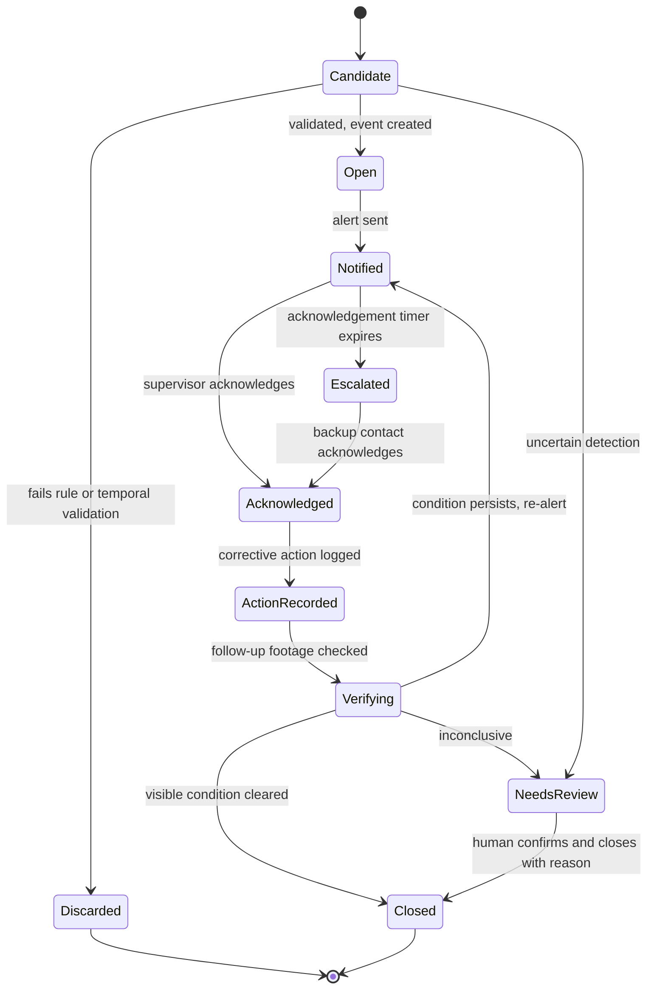
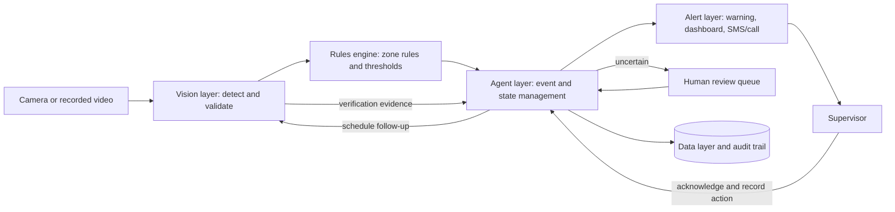

# GuardianLoop AI — Requirements Document

| | |
|---|---|
| **Product** | GuardianLoop AI — Construction Site Safety Agent |
| **Document type** | Product / System Requirements Specification |
| **Version** | 0.1 (Draft) |
| **Date** | 22 October 2026 |
| **Status** | For review |
| **Source** | GuardianLoop AI project brief |

---

## Table of Contents

1. [Purpose and Scope](#1-purpose-and-scope)
2. [Background and Problem Statement](#2-background-and-problem-statement)
3. [Stakeholders and User Roles](#3-stakeholders-and-user-roles)
4. [Assumptions, Constraints and Dependencies](#4-assumptions-constraints-and-dependencies)
5. [Product Concept and Workflow](#5-product-concept-and-workflow)
6. [Use Cases and Scenarios](#6-use-cases-and-scenarios)
7. [Functional Requirements](#7-functional-requirements)
8. [Non-Functional Requirements](#8-non-functional-requirements)
9. [Data Requirements](#9-data-requirements)
10. [System Architecture](#10-system-architecture)
11. [Safety, Ethics, Privacy and Compliance](#11-safety-ethics-privacy-and-compliance)
12. [MVP Scope and Development Plan](#12-mvp-scope-and-development-plan)
13. [Evaluation Plan and Success Metrics](#13-evaluation-plan-and-success-metrics)
14. [Demonstration Requirements](#14-demonstration-requirements)
15. [Differentiation Validation Plan](#15-differentiation-validation-plan)
16. [Risks and Mitigations](#16-risks-and-mitigations)
17. [Open Questions](#17-open-questions)
18. [Acceptance Criteria](#18-acceptance-criteria)
19. [Traceability: Phases to Requirements](#19-traceability-phases-to-requirements)
20. [Glossary](#20-glossary)

---

## 1. Purpose and Scope

### 1.1 Purpose

This document defines the requirements for **GuardianLoop AI**, a real-time AI agent that monitors construction-site safety, detects potential hazards, alerts the responsible supervisor, tracks corrective action, and checks whether the visible risk has been resolved.

The defining idea is a **closed-loop workflow**: a safety issue is tracked from detection through acknowledgement, corrective action, and verification. An alert on its own is not treated as success.

### 1.2 Scope

**In scope**

- Camera-based detection of potential hazards in configured construction zones
- Configurable, zone-specific safety rules
- Event creation with evidence, confidence score, location and time
- Alerting through local warning, dashboard, and SMS or automated call (simulated in the prototype)
- Acknowledgement tracking, corrective-action recording, and time-based escalation
- Follow-up verification of the visible condition, with human review for uncertain cases
- Audit trail, incident summaries, and recurrence analysis
- Evaluation of detection and workflow performance

**Out of scope (for the MVP)**

- Replacing trained safety officers or established emergency procedures
- Making disciplinary or employment decisions
- Facial recognition as a default worker-identification method
- Certifying that an entire site, or any area outside camera view, is safe
- Live production deployment without site-specific testing, safety approval, and privacy/legal review
- Hazard types beyond the MVP scenario set (see Section 6)

### 1.3 Target Users

- Construction contractors
- Health, Safety and Environment (HSE) officers
- Site supervisors
- Construction project managers

---

## 2. Background and Problem Statement

Construction sites contain moving machinery, restricted areas, elevated workspaces, electrical hazards, and workers performing different activities simultaneously. Periodic inspections may not continuously observe every location. Cameras can help, but an alert alone does not guarantee that anyone responds.

The system shall help answer:

| # | Question |
|---|---|
| Q1 | What potential hazard was detected? |
| Q2 | Where and when did it occur? |
| Q3 | Who is responsible for responding? |
| Q4 | Was the alert acknowledged? |
| Q5 | Was corrective action taken? |
| Q6 | Is there evidence that the visible risk has been resolved? |
| Q7 | Is the problem recurring, and what may be causing it? |

> **Important:** PPE detection, worker tracking, and escalation already exist in commercial products. The project must validate a narrower unmet need before claiming originality. See [Section 15](#15-differentiation-validation-plan).

---

## 3. Stakeholders and User Roles

### 3.1 Roles

| Role | Description | Primary needs |
|---|---|---|
| **Site Supervisor** | Responsible for a zone; first recipient of alerts | Receive alerts quickly, acknowledge, record corrective action |
| **HSE Officer** | Owns site safety program | Review uncertain events, configure rules, analyse recurrence, audit |
| **Project Manager** | Oversees delivery and risk | Summary reports, trend visibility |
| **Contractor Administrator** | Manages organisation and users | User and zone assignment, escalation policy |
| **System Administrator** | Maintains the platform | Camera setup, health monitoring, retention settings |
| **Agent (system actor)** | The automated GuardianLoop workflow | Detect, validate, notify, track, verify, escalate, record |

### 3.2 Permission Summary

| Capability | Supervisor | HSE Officer | Project Manager | Contractor Admin | System Admin |
|---|:---:|:---:|:---:|:---:|:---:|
| View events in assigned zones | ✔ | ✔ (all) | ✔ (summary) | ✔ | — |
| Acknowledge and record corrective action | ✔ | ✔ | — | — | — |
| Review uncertain events / close manually | — | ✔ | — | — | — |
| Configure zones and rules | — | ✔ | — | ✔ | — |
| Configure escalation policy | — | ✔ | — | ✔ | — |
| Manage users and assignments | — | — | — | ✔ | ✔ |
| View footage and evidence | ✔ (assigned) | ✔ | — | — | — |
| View audit trail | — | ✔ | ✔ (read) | ✔ | ✔ |
| Configure cameras and retention | — | — | — | — | ✔ |

---

## 4. Assumptions, Constraints and Dependencies

### 4.1 Assumptions

- **A1.** Each monitored zone has at least one camera with a usable view of the area of interest.
- **A2.** Each zone has a primary supervisor and a backup contact assigned by the site.
- **A3.** Required PPE and restricted areas are defined by the site and entered as rules.
- **A4.** The prototype runs on a single computer with a USB webcam or recorded video.
- **A5.** SMS and phone-call delivery is simulated in the prototype and uses a supported provider in later deployments.
- **A6.** Detections below the high-confidence threshold are routed for human review rather than treated as confirmed violations (configurable; see Open Question OQ-4).

### 4.2 Constraints

- **C1.** The agent must never automatically close an uncertain event.
- **C2.** The agent must never make disciplinary decisions.
- **C3.** A gesture, such as a thumbs-up, must not count as proof that a worker is safe or wearing required PPE.
- **C4.** Facial recognition must not be the default identification method.
- **C5.** Worker identification, where used at all, relies on a site-issued worker or badge identifier, and only where appropriate.
- **C6.** Escalation must follow the site's approved policy and only go to approved contacts.
- **C7.** Footage and event records require access controls and retention limits.

### 4.3 Dependencies

| Dependency | Needed for |
|---|---|
| Python runtime and OpenCV | Frame capture and processing |
| Person and PPE detection model | Detection layer |
| Notification provider (SMS / voice) | Remote alerts (later phase) |
| Computer-connected speaker or siren | Local warning |
| Annotated test footage | Evaluation |
| HSE professionals for interviews | Differentiation validation |

---

## 5. Product Concept and Workflow

### 5.1 Agent Workflow

**Observe → Detect → Validate → Create Event → Notify → Track Response → Verify → Close or Escalate → Audit**

### 5.2 Event Lifecycle

### 5.3 State Definitions

| State | Meaning |
|---|---|
| **Candidate** | A detection that has not yet passed rule and temporal validation |
| **Discarded** | Candidate rejected by validation; logged but not alerted |
| **Open** | Validated safety event created |
| **Notified** | Alert dispatched; awaiting acknowledgement |
| **Escalated** | Acknowledgement timer expired; backup contact notified |
| **Acknowledged** | A responsible person has accepted the alert |
| **ActionRecorded** | Corrective action has been documented |
| **Verifying** | Agent is checking subsequent footage |
| **NeedsReview** | Uncertain; waiting for human decision. Never auto-closed |
| **Closed** | Final state with a recorded closure reason |

### 5.4 Closure Reasons

`VerifiedResolved` · `HumanConfirmedResolved` · `FalsePositive` · `Duplicate` · `Other (with note)`

---

## 6. Use Cases and Scenarios

### UC-01 Worker Without a Helmet (MVP scenario)

| | |
|---|---|
| **Actor** | Agent, Site Supervisor |
| **Trigger** | A person in a helmet-required zone appears to be without a helmet |
| **Preconditions** | Zone and helmet rule configured; supervisor assigned; camera active |

**Main flow**

1. A camera observes a configured construction zone.
2. The vision model detects a person and identifies a possible missing-helmet condition.
3. The rules engine checks whether helmets are required in that zone.
4. The agent creates a safety event with time, location, confidence score, and evidence.
5. The system activates a local warning or alerts the assigned supervisor.
6. The supervisor acknowledges the alert and records the corrective action.
7. The camera checks subsequent footage for evidence that the condition has changed.
8. If the result is uncertain, the event remains open for human review.
9. If the event stays unacknowledged, the system escalates per the site's approved policy.
10. The agent records the final status and maintains the audit trail.

**Alternate flows**

- *Helmet not required in zone:* no event is created.
- *Low confidence:* event goes to the review queue.
- *Worker gives a thumbs-up:* ignored as evidence; verification continues on visual PPE state only.
- *Condition persists after acknowledgement:* agent re-alerts and may escalate.

### UC-02 Restricted-Zone Intrusion

Detect a person entering a configured restricted area and notify the authorized supervisor. *Priority: Should (post-core-MVP).*

### UC-03 Recurring Safety Violations

Identify recurring events, using an approved site-issued worker or badge identifier where appropriate, and help safety staff investigate possible causes such as missing PPE supplies, unclear rules, or incorrect zone configuration. *Priority: Should; validated through pilot.*

### UC-04 Potential Unsafe Proximity

Flag a person appearing too close to specified moving equipment, only when the camera view and model support a reliable assessment. Uncertain events require human review. *Priority: Could.*

### UC-05 Ambiguous Detection

An ambiguous detection (for example, occluded head, unusual headwear, poor lighting) is held in the review queue and is never auto-closed or auto-resolved. *Priority: Must.*

---

## 7. Functional Requirements

**Priority key (MoSCoW):** **M** = Must · **S** = Should · **C** = Could.
**Phase** refers to the MVP plan in [Section 12](#12-mvp-scope-and-development-plan). "Post" means after the MVP.

### 7.1 Camera Layer (CAM)

| ID | Requirement | Pri | Phase |
|---|---|:---:|:---:|
| CAM-01 | The system shall read frames from a USB webcam using OpenCV. | M | 1 |
| CAM-02 | The system shall accept recorded video files as an input source for repeatable testing and demonstrations. | M | 1 |
| CAM-03 | Each camera shall have a unique identifier and be associated with one or more zones. | M | 1 |
| CAM-04 | The system shall expose camera input behind a common interface so IP camera / CCTV streams can be added without changing downstream components. | S | 1 |
| CAM-05 | The system shall detect lost, frozen or degraded camera streams and raise a system-health notification, so a failed camera is never mistaken for "no hazards". | S | 4 |
| CAM-06 | The system shall support IP camera / CCTV integration. | C | Post |

### 7.2 Detection (DET)

| ID | Requirement | Pri | Phase |
|---|---|:---:|:---:|
| DET-01 | The system shall detect persons in each processed frame and output a bounding box and confidence score. | M | 2 |
| DET-02 | The system shall determine helmet presence or absence for each detected person within a configured zone. | M | 2 |
| DET-03 | Every detection shall carry a confidence score that is stored with any resulting event. | M | 2 |
| DET-04 | The system shall apply temporal validation: a condition must persist for a configurable number of frames or seconds before an event is created, to reduce single-frame false alarms. | M | 3 |
| DET-05 | The system shall support at least two configurable confidence thresholds: *confirmed* and *uncertain*. Detections between thresholds shall be routed to human review. | M | 3 |
| DET-06 | The detection model shall sit behind an interface so it can be replaced or retrained without changing the rules engine or agent logic. | S | 2 |
| DET-07 | The system shall detect a person inside a configured restricted-zone polygon. | S | 3 |
| DET-08 | The system shall flag a person near designated moving equipment only where the camera view supports reliable assessment; otherwise the event shall be marked uncertain. | C | Post |
| DET-09 | The system shall distinguish a missing helmet from other headwear (for example caps or hoods) as far as the model allows, and mark ambiguous cases as uncertain. | S | 2 |

### 7.3 Safety Rules (RUL)

| ID | Requirement | Pri | Phase |
|---|---|:---:|:---:|
| RUL-01 | Authorised users shall define zones as polygons on a camera view. | M | 3 |
| RUL-02 | Each zone shall support configurable rules, including required PPE, restricted-area flag, and (later) equipment proximity. | M | 3 |
| RUL-03 | The rules engine shall evaluate each validated detection against the rules for the zone and shall create no event when no rule applies. | M | 3 |
| RUL-04 | Thresholds (confidence, persistence, cooldown) shall be configurable per rule or zone. | M | 3 |
| RUL-05 | Each rule shall have a priority or severity level used for alert routing and escalation timers. | M | 3 |
| RUL-06 | Rules may be scheduled (for example active only during working hours). | C | Post |
| RUL-07 | Rule and zone changes shall be versioned and written to the audit trail. | S | 3 |

### 7.4 Event Management (EVT)

| ID | Requirement | Pri | Phase |
|---|---|:---:|:---:|
| EVT-01 | The agent shall create a safety event containing: event ID, timestamp, camera, zone, event type, confidence score, and evidence reference. | M | 3 |
| EVT-02 | The system shall capture at least one evidence snapshot per event and store it under access control. | M | 3 |
| EVT-03 | The system should capture a short evidence clip around the event time. | S | 4 |
| EVT-04 | The system shall suppress duplicate events for the same ongoing condition using a cooldown or merge rule, so one continuing violation does not produce repeated alerts. | M | 3 |
| EVT-05 | Events shall move only through the lifecycle states in Section 5.2, and every transition shall be logged with time and actor. | M | 5 |
| EVT-06 | Uncertain detections shall create a review-queue event rather than a confirmed event. Whether they also notify the supervisor shall be configurable per zone. | M | 3 |
| EVT-07 | The agent shall assign event priority from event type, zone, confidence, and recurrence history. | S | 5 |
| EVT-08 | Each event shall record why it was raised (rule matched, detections, confidence, frames used) so reviewers can understand the decision. | M | 3 |

### 7.5 Alerting and Notification (ALR)

| ID | Requirement | Pri | Phase |
|---|---|:---:|:---:|
| ALR-01 | The system shall determine the responsible supervisor from the zone assignment, including a primary and a backup contact. | M | 4 |
| ALR-02 | The system shall trigger a local warning through a computer-connected speaker or siren. Local warnings shall be configurable per zone and follow site policy. | M | 4 |
| ALR-03 | The system shall deliver real-time dashboard notifications. | M | 4 |
| ALR-04 | The system shall support SMS or automated phone-call alerts through a supported provider. The prototype may simulate this channel. | S | 4 |
| ALR-05 | Each alert shall include event type, location (camera and zone), time, confidence, evidence link, and an acknowledge action. | M | 4 |
| ALR-06 | The system shall record delivery status per channel (sent, delivered, failed). | M | 4 |
| ALR-07 | On delivery failure, the system shall retry or fall back to an alternate channel. | S | 4 |

### 7.6 Acknowledgement and Corrective Action (ACK)

| ID | Requirement | Pri | Phase |
|---|---|:---:|:---:|
| ACK-01 | A supervisor shall be able to acknowledge an alert from the dashboard and, where supported, from a link in an SMS. | M | 5 |
| ACK-02 | The system shall record who acknowledged and when. | M | 5 |
| ACK-03 | The supervisor shall be able to record corrective action using a structured category plus free-text notes. | M | 5 |
| ACK-04 | An authorised user shall be able to mark an event as a false positive with a reason; this feedback shall be stored for tuning and evaluation. | M | 5 |
| ACK-05 | An authorised user shall be able to reassign an event to another responsible person. | C | Post |
| ACK-06 | Acknowledgement alone shall not close or resolve an event. | M | 5 |

### 7.7 Escalation (ESC)

| ID | Requirement | Pri | Phase |
|---|---|:---:|:---:|
| ESC-01 | The system shall start an acknowledgement timer when an alert is sent. Timer length shall be configurable by priority. | M | 5 |
| ESC-02 | If the timer expires without acknowledgement, the system shall escalate according to the site's approved escalation policy. | M | 5 |
| ESC-03 | Escalation steps, contacts and timings shall be configurable, versioned, and restricted to approved contacts. | M | 5 |
| ESC-04 | Every escalation shall be recorded in the audit trail with time, recipient and delivery status. | M | 5 |
| ESC-05 | Escalation shall be limited to notification; the system shall not trigger disciplinary or employment actions. | M | 5 |
| ESC-06 | The system shall support multi-step escalation (for example supervisor, then backup, then HSE officer). | S | 5 |

### 7.8 Verification and Closure (VER)

| ID | Requirement | Pri | Phase |
|---|---|:---:|:---:|
| VER-01 | After corrective action is recorded, or after a configurable wait, the agent shall examine subsequent footage from the same camera and zone for the originally detected condition. | M | 6 |
| VER-02 | Verification shall return one of: **Resolved (visible)**, **Not resolved**, or **Inconclusive**. | M | 6 |
| VER-03 | An **Inconclusive** result shall keep the event open and place it in the human review queue. | M | 6 |
| VER-04 | The system shall not accept a gesture (for example a thumbs-up) or a verbal or typed statement as proof of PPE compliance. Verification is based on visual evidence or on explicit human confirmation. | M | 6 |
| VER-05 | The system shall store the verification evidence (snapshots or clips) and the result with the event. | M | 6 |
| VER-06 | Where visual evidence is insufficient, supervisor or HSE confirmation shall be required before closure. | M | 6 |
| VER-07 | If the condition persists after acknowledgement or recorded action, the system shall re-alert and may escalate. | S | 6 |
| VER-08 | The system shall support a limited number of scheduled re-checks per event. | S | 6 |
| VER-09 | "Resolved" shall mean only that the *visible* condition was no longer observed in the camera view. The system shall not state or imply that the zone or site is safe. | M | 6 |
| CLS-01 | The agent may auto-close an event only when verification is *Resolved (visible)* at or above the configured confidence and no uncertainty flag is set. The closure reason shall be recorded. | M | 6 |
| CLS-02 | Uncertain events shall never be auto-closed. | M | 6 |
| CLS-03 | Authorised users shall be able to close an event manually with a required reason. | M | 6 |
| CLS-04 | Authorised users should be able to reopen a closed event, with the reason recorded. | S | Post |

### 7.9 Audit and Reporting (AUD)

| ID | Requirement | Pri | Phase |
|---|---|:---:|:---:|
| AUD-01 | The system shall keep an append-only audit trail of event creation, state changes, alerts, acknowledgements, corrective actions, escalations, verification results, closures, rule or zone changes, and human overrides. | M | 5 |
| AUD-02 | Each audit entry shall record timestamp, actor (user or agent), action, and related event or configuration ID. | M | 5 |
| AUD-03 | The agent shall generate an incident summary per event. Generated summaries shall be labelled as such and link to the underlying evidence and audit entries. | S | 6 |
| AUD-04 | Authorised users shall be able to export event records and the audit trail for an agreed period. | S | 7 |

### 7.10 Recurrence Analysis (ANL)

| ID | Requirement | Pri | Phase |
|---|---|:---:|:---:|
| ANL-01 | The system shall identify recurring events by zone, camera, time window, and event type. | S | 7 |
| ANL-02 | Where the site approves it, the system may associate events with a site-issued worker or badge identifier. Facial recognition shall not be the default method. | C | Post |
| ANL-03 | The system shall present possible contributing factors (for example missing PPE supply, unclear rule, zone misconfiguration, shift patterns) as hypotheses for safety staff to investigate, not as conclusions. | S | Post |
| ANL-04 | The system shall let HSE users record interventions and compare recurrence before and after each one. | C | Post |
| ANL-05 | Recurrence outputs shall not be used to make automated disciplinary decisions about individuals. | M | Post |

### 7.11 Dashboard (DSH)

| ID | Requirement | Pri | Phase |
|---|---|:---:|:---:|
| DSH-01 | The dashboard shall show a live list of events with status, priority, zone, time, and confidence, with filtering. | M | 4 |
| DSH-02 | The event detail view shall show evidence, reason raised, alert and acknowledgement history, corrective action, verification result, and audit history. | M | 5 |
| DSH-03 | The dashboard shall provide a review queue for uncertain events with confirm, dismiss and close actions. | M | 6 |
| DSH-04 | Authorised users shall be able to configure zones, rules, assignments, and escalation policy through the interface or configuration files. | M | 3 |
| DSH-05 | The dashboard shall show key metrics (see Section 13). | S | 7 |
| DSH-06 | Access shall be role-based as described in Section 3.2. | M | 4 |

---

## 8. Non-Functional Requirements

> Numeric targets below are **proposed starting values**. They must be baselined on the target hardware and test footage during Phases 2 and 7, then confirmed or revised by the project team.

### 8.1 Performance

| ID | Requirement | Proposed target |
|---|---|---|
| NFR-P1 | Time from the moment a validated condition is detected to a dashboard or local warning | ≤ 5 seconds |
| NFR-P2 | Time from validated detection to SMS / call hand-off to the provider (excluding provider delay) | ≤ 10 seconds |
| NFR-P3 | Frame processing rate sufficient for temporal validation on the prototype hardware | Baseline in Phase 2 |
| NFR-P4 | Dashboard refresh for new events | ≤ 3 seconds |

### 8.2 Accuracy and Quality

| ID | Requirement |
|---|---|
| NFR-A1 | Precision, recall, and false alerts per camera-hour shall be measured on annotated test footage and reported. |
| NFR-A2 | Thresholds shall be tunable per zone so sites can balance missed detections against alert fatigue. |
| NFR-A3 | Evaluation footage shall include difficult cases: low light, glare, occlusion, distance, different helmet colours and shapes, caps, hoods, and crowded scenes. |
| NFR-A4 | Known limitations (for example camera angle dependence) shall be documented and visible to users. |

### 8.3 Reliability and Availability

| ID | Requirement |
|---|---|
| NFR-R1 | Open events and their states shall persist across application restarts. |
| NFR-R2 | The system shall continue processing other cameras if one camera fails. |
| NFR-R3 | Notifications that cannot be sent immediately shall be queued and retried. |
| NFR-R4 | Escalation timers shall survive restarts and resume with correct remaining time. |
| NFR-R5 | A detection or notification component failure shall be surfaced to administrators. |

### 8.4 Security

| ID | Requirement |
|---|---|
| NFR-S1 | Users shall authenticate, and access shall be controlled by role. |
| NFR-S2 | Data in transit (dashboard, notification provider, camera streams where supported) shall be encrypted. |
| NFR-S3 | Credentials and provider keys shall be stored as secrets, not in source code. |
| NFR-S4 | Evidence storage shall be access-controlled, and access to footage shall be logged. |
| NFR-S5 | Audit records shall be tamper-evident or append-only. |

### 8.5 Privacy and Data Protection

| ID | Requirement |
|---|---|
| NFR-D1 | Footage and event records shall have configured retention limits and be deleted or anonymised when the limit is reached. |
| NFR-D2 | The system shall collect and store only the footage and data needed for safety events, verification, and approved analysis. |
| NFR-D3 | Facial recognition shall be disabled by default. |
| NFR-D4 | Deployment shall be preceded by privacy and legal review for the site and jurisdiction, including notice to workers where required. |

### 8.6 Usability

| ID | Requirement | Proposed target |
|---|---|---|
| NFR-U1 | A supervisor shall be able to acknowledge an alert in few steps from the notification. | ≤ 2 steps |
| NFR-U2 | Alerts shall be understandable without technical knowledge of the vision model. | — |
| NFR-U3 | Alert and signage text shall support the site's working languages. | Per site |

### 8.7 Explainability and Transparency

| ID | Requirement |
|---|---|
| NFR-X1 | For each event the system shall show the triggering rule, detection confidence, and evidence. |
| NFR-X2 | The UI shall label uncertain results as uncertain and shall not present them as confirmed. |
| NFR-X3 | The system shall not present a "resolved" status as a guarantee of safety. |

### 8.8 Maintainability and Testability

| ID | Requirement |
|---|---|
| NFR-M1 | Detection model, camera source, notification channel and rules shall be modular and replaceable. |
| NFR-M2 | Zone, rule and escalation configuration shall be stored as data, not hard-coded. |
| NFR-M3 | The system shall be able to replay recorded footage to give repeatable test results. |
| NFR-M4 | Core logic (rules, state machine, escalation timers) shall have automated tests. |

### 8.9 Portability

| ID | Requirement |
|---|---|
| NFR-T1 | The prototype shall run on a single laptop or desktop computer with a USB webcam. |
| NFR-T2 | The design shall not prevent later deployment against IP cameras or CCTV and on site or cloud infrastructure. |

---

## 9. Data Requirements

### 9.1 Core Entities

| Entity | Key fields |
|---|---|
| **Camera** | camera_id, name, source type (webcam / file / IP), status, assigned zones |
| **Zone** | zone_id, camera_id, polygon geometry, name, assigned supervisor, backup contact |
| **Rule** | rule_id, zone_id, rule type (PPE / restricted / proximity), required PPE, thresholds, priority, version, active flag |
| **Event** | event_id, timestamp, camera_id, zone_id, event_type, confidence, status, priority, reason raised, evidence references, closure reason |
| **Alert** | alert_id, event_id, channel, recipient, sent time, delivery status |
| **Acknowledgement** | event_id, user, time, channel |
| **CorrectiveAction** | event_id, category, notes, recorded by, time |
| **Verification** | verification_id, event_id, time, result (Resolved / Not resolved / Inconclusive), confidence, evidence references, reviewer (if human) |
| **EscalationPolicy** | policy_id, steps, timers, contacts, version |
| **AuditEntry** | entry_id, timestamp, actor, action, target ID, details |
| **User** | user_id, name, role, contact details, status |

### 9.2 Minimum Event Record

Each event shall store at least:

- Event ID
- Timestamp
- Camera and zone
- Event type
- Confidence score
- Alert delivery and acknowledgement status
- Corrective action
- Verification status
- Closure reason

### 9.3 Retention and Access

| Data | Retention | Access |
|---|---|---|
| Evidence snapshots and clips | To be set by site policy and legal review | Assigned supervisor, HSE Officer |
| Event records | To be set by site policy | Role-based |
| Audit trail | To be set by site policy; longer than footage | HSE Officer, Admins |
| Raw continuous video | Not stored by default; only event-related segments | System Admin (configuration only) |

---

## 10. System Architecture

### 10.1 Layers

| Layer | Responsibilities | Technology / notes |
|---|---|---|
| **Camera layer** | Frame capture from webcam, recorded video, later IP/CCTV | USB webcam, OpenCV |
| **Computer vision layer** | Person and PPE detection, zone geometry, temporal checks | Python, OpenCV, detection model |
| **Agent layer** | Event classification and prioritisation, rule checking, alert routing, acknowledgement tracking, follow-up scheduling, resolution status, incident summaries | Workflow engine / state machine |
| **Alert layer** | Local warning, dashboard notification, SMS or call, escalation | Speaker/siren, dashboard, provider API |
| **Data layer** | Events, alerts, actions, verification, audit, evidence | Database plus access-controlled evidence storage |

### 10.2 Data Flow

### 10.3 Design Principles

1. **Human in the loop** for uncertain and high-impact cases.
2. **Closed loop:** no event is complete until it is verified or reviewed.
3. **Configuration over code** for zones, rules, thresholds and escalation.
4. **Replaceable components** for model, camera source and notification channel.
5. **Evidence and audit by default** for every decision.

---

## 11. Safety, Ethics, Privacy and Compliance

### 11.1 Limitations (must be communicated to users)

- Camera detection can miss hazards or produce false alarms.
- One camera cannot establish that an entire site is safe.
- Human oversight is required for uncertain and high-impact cases.
- The system must not replace trained safety officers or established emergency procedures.

### 11.2 Ethical and Privacy Controls

| Control | Requirement |
|---|---|
| Worker identification | Facial recognition is not the default. Use a site-issued worker or badge identifier only where appropriate and approved. |
| Disciplinary use | The agent shall not make or trigger disciplinary decisions. Outputs support safety investigation, not punishment. |
| Transparency | Workers should be informed of monitoring where required, and signage should be present. |
| Data minimisation | Store only event-related footage and necessary metadata. |
| Retention | Configure retention limits; delete or anonymise afterward. |
| Access | Role-based access to footage and records; access is logged. |
| Review | Live deployment requires site-specific testing, safety approval, and privacy/legal review. |

### 11.3 Compliance

- The deployment team shall identify and document applicable occupational safety, data protection, and workplace-monitoring requirements for each site and jurisdiction before live use.
- The project shall not claim regulatory compliance or certification without formal assessment.

---

## 12. MVP Scope and Development Plan

### 12.1 Phases

| Phase | Name | Deliverables | Exit criteria |
|---|---|---|---|
| **1** | Camera integration | Webcam and recorded-video input via OpenCV; camera registry | Frames read reliably from both webcam and file |
| **2** | Detection | Person detection and helmet detection for one scenario; confidence output | Model produces detections with confidence on test footage; baseline metrics recorded |
| **3** | Safety rules | Zone polygons, zone rules, thresholds, temporal validation, event creation with evidence | Event created only when a rule applies and the condition persists; duplicates suppressed |
| **4** | Notifications | Dashboard, local speaker/siren, simulated SMS; delivery status | Alerts reach the assigned supervisor with delivery status recorded |
| **5** | Agentic follow-up | Acknowledgement tracking, corrective-action recording, escalation timers, state machine, audit trail | Unacknowledged event escalates; every transition is audited |
| **6** | Verification | Follow-up footage comparison, human review queue, closure logic, incident summary | Resolved, not resolved and inconclusive outcomes handled; uncertain events never auto-closed |
| **7** | Evaluation | Metrics pipeline, annotated test set, evaluation report | All metrics in Section 13 reported |

### 12.2 MVP Definition

The MVP is complete when **UC-01** (helmet in a configured zone) runs end to end through all ten steps, uncertain results stay open for review, and the demonstration in Section 14 can be performed from recorded footage.

### 12.3 Post-MVP Candidates

Restricted-zone intrusion at scale, equipment proximity, IP camera / CCTV integration, recurrence analysis with identifiers, intervention tracking, event reassignment, scheduled rules.

---

## 13. Evaluation Plan and Success Metrics

### 13.1 Metrics

| Metric | Definition |
|---|---|
| Detection precision | True violations among all raised events |
| Detection recall | Violations detected among all actual violations in the test set |
| False-alert rate | False alerts per camera-hour |
| Alert delivery time | Time from event creation to delivery on each channel |
| Notification latency | Time from validated detection to alert dispatch |
| Acknowledgement time | Time from alert delivery to acknowledgement |
| Documented-action rate | Percentage of events with recorded corrective action |
| Verified-resolution rate | Percentage of events with a verification result of Resolved (visible) |
| Verification correctness | Percentage of verification results that match human ground truth |
| Escalation rate | Percentage of events needing escalation |
| Review-queue rate | Percentage of events routed to human review |
| Recurrence change | Change in recurring incidents, only where measured through a valid pilot |

### 13.2 Test Data Requirements

- Annotated recorded footage with ground truth for helmet present and absent
- Hard negatives and edge cases (see NFR-A3)
- Footage of both unresolved and corrected conditions for verification testing
- Separate sets for tuning and final reporting

### 13.3 Targets

Target values for precision, recall, false-alert rate and verification correctness are **to be set after the Phase 2 baseline**. They shall be agreed with HSE stakeholders because acceptable trade-offs depend on the site.

---

## 14. Demonstration Requirements

| Step | Demonstration | Linked requirements |
|---|---|---|
| 1 | Play a staged video showing a possible PPE violation. | CAM-02, DET-01, DET-02 |
| 2 | Display the detected event and its confidence. | EVT-01, EVT-08 |
| 3 | Trigger a local warning and a simulated supervisor notification. | ALR-02, ALR-04, ALR-05 |
| 4 | Demonstrate acknowledgement and corrective-action recording. | ACK-01 to ACK-03 |
| 5 | Play a follow-up clip showing the visible condition corrected. | VER-01, VER-02 |
| 6 | Show the event's verification status and audit history. | VER-05, AUD-01, DSH-02 |
| 7 | Demonstrate an ambiguous detection remaining open for review. | DET-05, EVT-06, VER-03, CLS-02 |

Optional additions: show escalation after an unacknowledged alert (ESC-01, ESC-02) and show a thumbs-up gesture being rejected as proof (VER-04).

---

## 15. Differentiation Validation Plan

### 15.1 Position

The central research question is whether GuardianLoop can help identify the **causes of recurring safety violations** and measure whether interventions reduce recurrence. This is a **hypothesis, not a proven unique capability**, and must not be presented as novel until validated.

### 15.2 Hypotheses

| ID | Hypothesis |
|---|---|
| H1 | HSE professionals lack an effective way to see *why* the same violation recurs, beyond counting alerts. |
| H2 | Closed-loop tracking (acknowledgement, action, verification) meaningfully improves response compared with alert-only tools. |
| H3 | Surfacing contributing factors (supply gaps, unclear rules, zone misconfiguration) helps safety staff choose better interventions. |
| H4 | Measuring recurrence before and after an intervention is of practical value to HSE teams. |

### 15.3 Validation Activities

1. Review commercial and open-source competitors for PPE detection, escalation, corrective-action tracking, and recurrence analysis.
2. Interview HSE officers, site supervisors, and project managers about current workflow and gaps.
3. Map each hypothesis to evidence from the interviews and competitor review.
4. Run a small pilot or controlled demonstration where recurrence can be measured.
5. Report findings, including where existing products already cover the need.

### 15.4 Output

A short findings document that states which parts of GuardianLoop are validated as a real gap, which are already covered by existing products, and which remain unproven.

---

## 16. Risks and Mitigations

| ID | Risk | Likelihood | Impact | Mitigation |
|---|---|:---:|:---:|---|
| R1 | False alarms cause alert fatigue and ignored alerts | High | High | Temporal validation, tunable thresholds, cooldown, false-positive feedback, measure false alerts per camera-hour |
| R2 | Missed detections give false confidence | Med | High | Communicate limitations, report recall, never claim site is safe, keep human inspections |
| R3 | Camera angle, lighting or occlusion degrade accuracy | High | Med | Test on varied footage, document supported camera setups, mark ambiguous cases uncertain |
| R4 | Incorrect auto-closure hides an unresolved hazard | Low | High | Auto-close only on confident visual resolution; uncertain events never auto-closed; human confirmation when evidence is insufficient |
| R5 | Privacy concerns or worker pushback | Med | High | No facial recognition by default, data minimisation, retention limits, worker notice, legal review |
| R6 | Misuse for disciplinary purposes | Med | High | Explicit constraint; outputs framed as safety investigation; no automated discipline |
| R7 | Camera outage unnoticed | Med | High | Stream-health monitoring and notification (CAM-05) |
| R8 | Notification provider failure or delay | Med | Med | Delivery tracking, retry, fallback channel, local warning |
| R9 | Product is not meaningfully differentiated | Med | Med | Differentiation validation plan; avoid unvalidated novelty claims |
| R10 | Insufficient or biased training and test data | Med | Med | Diverse annotated footage; separate tuning and test sets |
| R11 | Misconfigured zones or rules produce wrong alerts | Med | Med | Versioned configuration, review of zone setup, recurrence analysis flags zone misconfiguration as a possible cause |
| R12 | Acknowledgement is treated as resolution | Med | Med | ACK-06 and verification step required before closure |

---

## 17. Open Questions

| ID | Question | Owner | Needed by |
|---|---|---|---|
| OQ-1 | Which detection model and training data will be used for person and helmet detection? | Project team | Phase 2 |
| OQ-2 | What camera placement and minimum resolution are required for reliable helmet detection? | Project team | Phase 2 |
| OQ-3 | Which SMS / voice provider will be used after the prototype? | Project team | Phase 4 |
| OQ-4 | Should uncertain detections notify the supervisor immediately or wait in the review queue by default? | HSE stakeholders | Phase 3 |
| OQ-5 | What are the acknowledgement timer lengths and escalation steps for each priority? | HSE stakeholders | Phase 5 |
| OQ-6 | How long may footage and event records be retained? | Site / legal | Phase 3 |
| OQ-7 | How is zone-to-supervisor assignment maintained (manual, shift roster, HR system)? | Project team | Phase 4 |
| OQ-8 | Is a worker or badge identifier available on the target site, and is its use approved? | Site / legal | Post |
| OQ-9 | Will deployment be local, cloud, or hybrid? | Project team | Post |
| OQ-10 | Which languages must alerts and dashboard support? | Site | Phase 4 |
| OQ-11 | What target precision, recall and false-alert rate will stakeholders accept? | HSE stakeholders | After Phase 2 baseline |
| OQ-12 | Is the local siren appropriate for the site, or should alerts be silent and dashboard only? | Site | Phase 4 |

---

## 18. Acceptance Criteria

| ID | Criterion (Given / When / Then) | Related requirements |
|---|---|---|
| AC-01 | **Given** a zone requiring helmets and a recorded clip of a person without one, **when** the clip is processed, **then** an event is created with timestamp, camera, zone, confidence and evidence. | DET-02, RUL-03, EVT-01, EVT-02 |
| AC-02 | **Given** a zone that does not require helmets, **when** a person without a helmet appears, **then** no event is created. | RUL-03 |
| AC-03 | **Given** a condition seen for only a single frame, **when** temporal validation is on, **then** no event is created. | DET-04 |
| AC-04 | **Given** a validated event, **when** it is created, **then** the assigned supervisor receives an alert with delivery status recorded. | ALR-01 to ALR-06 |
| AC-05 | **Given** an alert sent and no acknowledgement within the configured time, **when** the timer expires, **then** the system escalates per policy and records the escalation. | ESC-01 to ESC-04 |
| AC-06 | **Given** a supervisor acknowledgement and corrective action, **when** follow-up footage shows the helmet worn, **then** verification returns Resolved (visible), the event closes with reason `VerifiedResolved`, and evidence is stored. | ACK-01 to ACK-03, VER-01, VER-02, CLS-01 |
| AC-07 | **Given** follow-up footage where the head is occluded or the view is unclear, **when** verification runs, **then** the result is Inconclusive and the event stays open in the review queue. | VER-02, VER-03, CLS-02 |
| AC-08 | **Given** a worker making a thumbs-up gesture without wearing a helmet, **when** verification runs, **then** the gesture is not accepted as proof and the condition remains unresolved. | VER-04 |
| AC-09 | **Given** a condition that persists after acknowledgement, **when** verification runs, **then** the system re-alerts and may escalate. | VER-07 |
| AC-10 | **Given** any event, **when** its history is viewed, **then** every state change, alert, acknowledgement, action and verification is shown with time and actor. | AUD-01, AUD-02, DSH-02 |
| AC-11 | **Given** a continuing violation, **when** it persists across many frames, **then** only one event is raised within the cooldown window. | EVT-04 |
| AC-12 | **Given** the application restarts with open events, **when** it comes back up, **then** the events, states and escalation timers are restored. | NFR-R1, NFR-R4 |
| AC-13 | **Given** evaluation on the annotated test set, **when** testing completes, **then** precision, recall, false alerts per camera-hour, notification latency, acknowledgement time, and verified-resolution rate are reported. | Section 13 |
| AC-14 | **Given** any resolved or closed status, **when** it is shown to a user, **then** it does not state or imply that the zone or site is safe. | VER-09, NFR-X3 |

---

## 19. Traceability: Phases to Requirements

| Phase | Primary requirement groups |
|---|---|
| 1 Camera integration | CAM-01 to CAM-04 |
| 2 Detection | DET-01 to DET-03, DET-06, DET-09 |
| 3 Safety rules | DET-04, DET-05, DET-07, RUL-01 to RUL-05, RUL-07, EVT-01, EVT-02, EVT-04, EVT-06, EVT-08, DSH-04 |
| 4 Notifications | CAM-05, EVT-03, ALR-01 to ALR-07, DSH-01, DSH-06 |
| 5 Agentic follow-up | EVT-05, EVT-07, ACK-01 to ACK-06, ESC-01 to ESC-06, AUD-01, AUD-02, DSH-02 |
| 6 Verification | VER-01 to VER-09, CLS-01 to CLS-03, AUD-03, DSH-03 |
| 7 Evaluation | AUD-04, ANL-01, DSH-05, NFR-A1 to NFR-A4, Section 13 |
| Post-MVP | CAM-06, DET-08, RUL-06, ACK-05, CLS-04, ANL-02 to ANL-05 |

---

## 20. Glossary

| Term | Meaning |
|---|---|
| **HSE** | Health, Safety and Environment |
| **PPE** | Personal protective equipment, for example helmet, vest, gloves |
| **CCTV** | Closed-circuit television |
| **Zone** | A defined area in a camera view, with its own rules and responsible supervisor |
| **Event** | A recorded potential safety hazard with time, place, confidence and evidence |
| **Temporal validation** | Requiring a condition to persist across frames or time before raising an event |
| **Confidence score** | The model's estimated likelihood that a detection is correct |
| **Acknowledgement** | Confirmation by a responsible person that they received and accepted an alert |
| **Corrective action** | The action taken to remove or reduce the hazard |
| **Verification** | Checking subsequent footage for evidence that the visible condition changed |
| **Escalation** | Notifying a backup or higher contact when an alert is not acknowledged in time |
| **Review queue** | List of uncertain events awaiting a human decision |
| **Audit trail** | Append-only record of events, decisions and changes |
| **Closed loop** | Workflow that continues from detection through response and verification |
| **MoSCoW** | Prioritisation scheme: Must, Should, Could |
| **MVP** | Minimum viable product |
