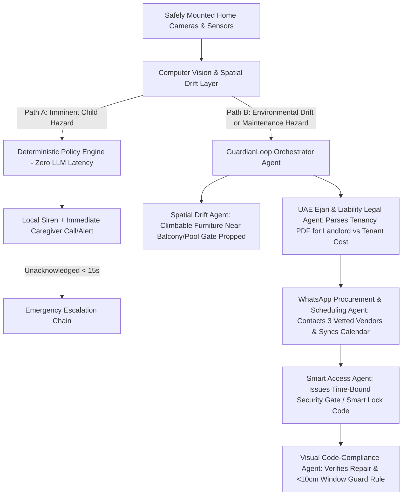
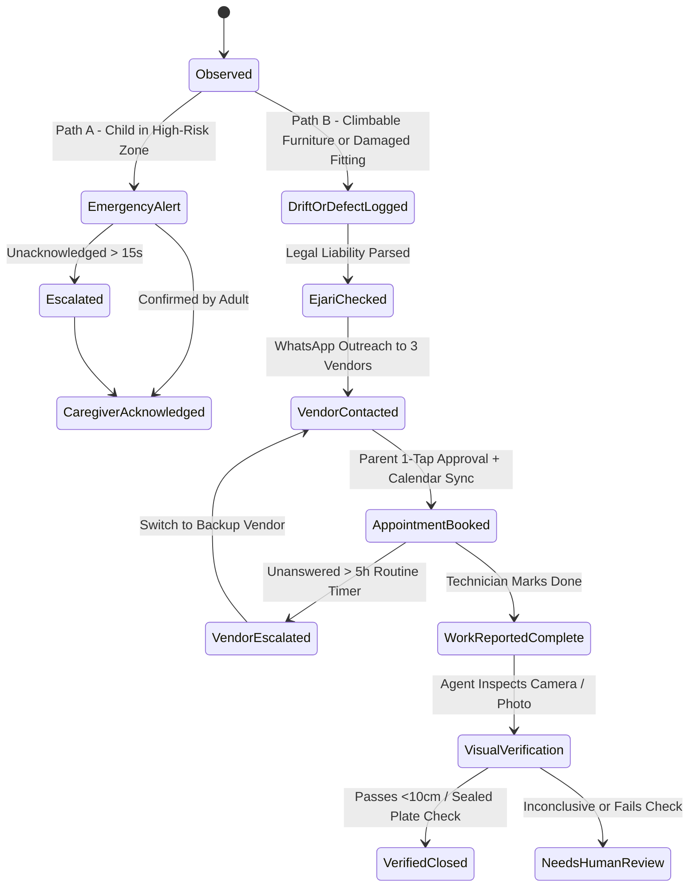

# GuardianLoop AI — The Autonomous Child & Home Hazard-to-Resolution Agent

| | |
|---|---|
| **Product** | GuardianLoop AI — Child & Home Safety Agent (v2.0 Championship Edition) |
| **Target Category** | Best Personal AI Agent (or Best Societal AI Agent) |
| **Rating Position** | 9.5 / 10 (Upgraded Multi-Agent Autonomous Architecture) |
| **Prepared** | 22 October 2026 |
| **Purpose** | Comprehensive concept & requirements brief for the Create AI Agents Championship (Dubai Chambers) |

---

## 1. The Problem & UAE Evidence

Young children can approach fatal household hazards in seconds, while routine household maintenance issues (broken window locks, cracked electrical sockets, propped-open pool gates) often remain unresolved for weeks due to landlord-tenant friction and scheduling delays.

1. **UAE Study of Falls from Windows and Balconies:** A peer-reviewed retrospective study of unintentional child falls in the UAE (2005–2016) documented 81 cases (66 fatal, 15 hospitalised). Crucially, **climbable furniture placed near windows or balconies was involved in 27% of cases** [1].
2. **Official UAE Child-Safety Guidance:** The Abu Dhabi Public Health Centre (*Safety of Children at Home Guide*) mandates moving climbable furniture away from windows, installing window guards that **limit opening width to $< 10\text{ cm}$** in multi-level homes, keeping balcony doors locked, and securing electrical fittings [2].
3. **Recent Private Pool Tragedies:** In October 2025, *Khaleej Times* reported a two-year-old boy drowning in a private farm pool in Dibba Al-Fujairah during a brief gap in supervision [3].
4. **Advancing Beyond Prior Art (FATEEN):** UAE University’s 2025 *FATEEN* research project demonstrated AI toddler pool detection with a floating IoT device [4]. GuardianLoop AI differentiates itself by combining **proactive environmental drift detection** (identifying moved furniture *before* a child climbs it), **deterministic sub-second emergency alerts**, and an **autonomous multi-agent maintenance resolution engine** that parses UAE tenancy contracts (Ejari), negotiates with technicians via WhatsApp, and visually verifies code compliance ($< 10\text{ cm}$ window gap) before closing a case.

---

## 2. Core Multi-Agent Architecture

GuardianLoop AI operates on two distinct speed and autonomy tracks:

### Path A: Immediate Child-Safety Events (Sub-Second Deterministic Path)
* **Zero LLM Bottleneck:** When a toddler enters a configured pool-access zone or climbs near an unguarded window, safety-critical alarms never wait for an LLM to generate tokens. A deterministic policy engine fires the local siren and caregiver notification in $\le 2\text{ seconds}$.
* **Escalation:** If unacknowledged within $15\text{ seconds}$, it triggers the pre-approved household emergency escalation tree (secondary parent, live-in caregiver, building security desk).

### Path B: Proactive Spatial Drift & Autonomous Maintenance Resolution (Agentic Path)
1. **Proactive "Spatial Drift" Detection Agent:** Rather than waiting for a child to climb onto a balcony, the agent conducts periodic spatial audits. If a cleaner or family member moves a chair, crib, or table within $1\text{ meter}$ of a balcony railing or props open a pool gate, the agent flags the **environmental precondition** hours before an accident can occur.
2. **Ejari & Landlord-Liability Legal Agent:** When a physical defect is detected or reported (e.g., broken window restrictor, cracked electrical socket, faulty pool gate latch), the agent reads the family’s **Dubai Ejari / Tenancy Contract PDF**. It checks the maintenance threshold clause (typically $\text{AED } 500$ in Dubai) to determine if the repair is **Landlord Liability** (structural/major) or **Tenant Responsibility** (minor), and automatically drafts the formal notice or work order.
3. **WhatsApp Vendor-Negotiation & Booking Agent:** Using the WhatsApp Business API, the agent autonomously messages 3 pre-vetted maintenance providers (or building FM), cross-references the parents' Google/Apple Calendar for free slots, negotiates quotes, and presents a 1-tap approval card to the homeowner.
4. **UAE Code-Compliance Visual Inspector Agent:** A technician texting "Done" never closes a case. Once the technician finishes, the Vision Agent inspects the room camera (or an uploaded photo with metadata) to verify that the electrical cover is intact or that the newly installed window restrictor limits the opening width to **$< 10\text{ cm}$** per Abu Dhabi Public Health Centre guidelines.

---

## 3. End-to-End Use Cases

### Use Case 1: Proactive Balcony Drift + Immediate Pool-Zone Intervention
* **Actors:** Spatial Drift Agent, Deterministic Emergency Engine, Parents (via WhatsApp).
* **Flow:**
  1. At 10:00 AM, a patio chair is placed directly against a 12th-floor balcony railing while the balcony door lock is unlatched.
  2. **Spatial Drift Agent** detects a climbable object within the $1.0\text{ m}$ balcony hazard buffer and sends a non-siren WhatsApp visual alert to the parents: *"Pre-Hazard Detected: Climbable chair moved next to unlatched balcony railing."*
  3. At 4:15 PM, a toddler pushes open a backyard pool gate.
  4. **Deterministic Engine** detects a child-sized person inside the pool risk polygon while the gate sensor reads `OPEN`.
  5. Within $1.5\text{ seconds}$, the poolside siren sounds and high-priority push/voice alerts fire to the caregiver's phone.
  6. If unacknowledged after $15\text{ seconds}$, the agent calls the secondary caregiver and logs exact delivery and acknowledgement timestamps without ever falsely declaring the child "safe" until human confirmation.

### Use Case 2: Autonomous Electrical & Window-Lock Hazard-to-Resolution Loop
* **Actors:** Homeowner, Ejari Legal Agent, WhatsApp Booking Agent, Technician, Visual Inspector Agent.
* **Flow:**
  1. A resident snaps a photo (or the room camera detects) a **cracked electrical switch cover** and a **broken window restrictor lock** in the child’s bedroom.
  2. **Diagnostic Agent** classifies both as `Potential Child Hazards` with confidence scores and explicit safety disclaimers (never instructing an unqualified resident to touch live wiring).
  3. **Ejari Legal Agent** parses the household's tenancy contract PDF:
     * Labels the cracked switch + window restrictor replacement ($\text{est. AED } 280$) as *Tenant Minor Maintenance* (below the $\text{AED } 500$ landlord threshold).
  4. **WhatsApp Booking Agent** messages 3 licensed maintenance companies in Dubai, retrieves availability, matches it against the homeowner's calendar for Thursday 2:00 PM–4:00 PM, and books the lowest vetted quote ($\text{AED } 250$) after a 1-tap WhatsApp confirmation from the parent.
  5. **Follow-Up & Escalation:** If the vendor fails to confirm arrival within the configured routine window (e.g., 5 hours), the agent automatically cancels and books the backup vendor.
  6. **Visual Code Verification:** After the technician completes the repair, the agent requests a verification capture. It confirms the switch plate is sealed and measures the window opening ratio against reference geometry to confirm the restrictor stops at $< 10\text{ cm}$. Only then does the state transition from `reported_complete` to `verified_closed`.

---

## 4. State Machine & Guardrails

### Mandatory Safety & Privacy Guardrails
* **Physical Prevention First:** UI and onboarding explicitly mandate physical window guards, pool fencing, and adult supervision.
* **No Wearable Hazards:** Strictly prohibits infant neck-mounted or wearable cameras that pose strangulation or battery-ingestion risks.
* **Privacy & Edge Processing:** Spatial drift and child-zone detection run locally on edge hardware where possible; no facial recognition is used, and video clips are encrypted with strict retention limits.
* **Zero False Reassurance:** When a camera is offline, occluded, or in low light, the dashboard displays `MONITORING DEGRADED`—never `ALL CLEAR`.

---

## 5. 2-Minute Championship Demo Script (Live Prototype Plan)

1. **0:00–0:30 (Proactive Drift + Emergency Path A):** Place a chair next to a simulated window zone (`Spatial Drift Alert` triggers on WhatsApp). Then move a child mannequin into a mocked pool zone—demonstrating the instant $< 2\text{ second}$ deterministic siren and automatic escalation when the primary phone ignores the alert.
2. **0:30–1:15 (Agentic Ejari & WhatsApp Negotiation Path B):** Show a damaged electrical socket and broken window lock. Watch the **Ejari Agent** highlight the $\text{AED } 500$ maintenance clause in a real Dubai tenancy contract PDF, then watch the **WhatsApp Agent** negotiate live with a simulated vendor bot and book a calendar slot.
3. **1:15–1:45 (Visual Verification Rejecting Fake Closure):** The technician sends a WhatsApp message saying *"Job done!"* while the switch is still cracked. The **Verification Agent** checks the camera feed, **rejects the closure**, and keeps the ticket open.
4. **1:45–2:00 (Verified Closure & Commercial Pitch):** Replace the broken cover with an intact cover and a $< 10\text{ cm}$ window guard; the agent visually verifies compliance, closes the audit loop, and pitches the B2B2C revenue model with UAE developers (Emaar, Aldar, Nakheel) and home insurers.

---

## 6. Sources & Evidence
* [1] Grivna, M., et al. (2017), *Pediatric falls from windows and balconies: incidents and risk factors as reported by newspapers in the UAE*, World Journal of Emergency Surgery, 12:32.
* [2] Abu Dhabi Public Health Centre, *Safety of Children at Home Guide*.
* [3] Khaleej Times (29 Oct 2025), *UAE: 2-year-old boy drowns in swimming pool at a private farm in Fujairah*.
* [4] UAE University (2025), *FATEEN: An AI-Empowered Floating IoT System for Enhancing Toddler Pool Safety*.