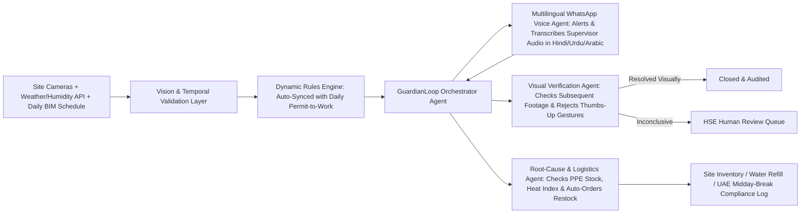
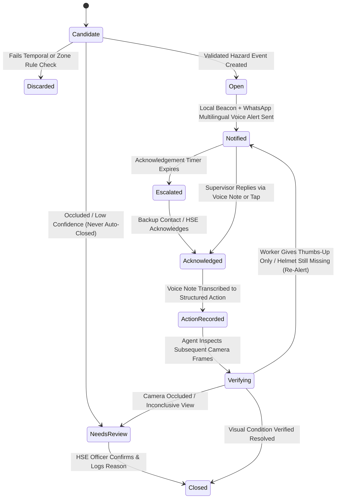

# GuardianLoop AI — Autonomous Construction Safety, Heat-Compliance & Root-Cause Agent

| | |
|---|---|
| **Product** | GuardianLoop AI — Construction Site Safety & Worker Welfare Agent (v2.0 Championship Edition) |
| **Target Category** | Best Societal AI Agent (Worker Welfare & Social Resilience) or Best Business AI Agent |
| **Rating Position** | 9.6 / 10 (Merged Closed-Loop Vision + Multilingual Voice + Heat & Logistics Autonomy) |
| **Prepared** | 22 October 2026 |
| **Purpose** | Product & System Requirements Specification for the Create AI Agents Championship |

---

## 1. Purpose & Championship Differentiation

Standard computer-vision PPE detectors fail on real Gulf construction sites for three reasons:
1. **Alert Fatigue Without Action:** Cameras generate thousands of "missing helmet" alerts, but nobody tracks whether the supervisor acknowledged the alert or whether the worker actually put the helmet on.
2. **Language & Field Friction:** Site supervisors working in $42^\circ\text{C}$ heat cannot type free-text corrective action reports into an English web dashboard while wearing safety gloves.
3. **Ignoring Environmental & Supply Root Causes:** If 15 workers remove their helmets in Zone C at 1:30 PM, the root cause is rarely "worker negligence"—it is usually **extreme wet-bulb heat stress**, **empty water stations**, or **depleted breathable PPE stock** at the zone gate.

**GuardianLoop AI** solves this with a **4-Agent Closed-Loop Architecture** that combines **Visual Verification** (rejecting fake "thumbs-up" gestures), **Multilingual WhatsApp Voice-Note Supervisor Loops** (Hindi, Urdu, Malayalam, Arabic, English), **UAE Midday-Break Heat-Safety Compliance**, and **Autonomous Root-Cause Inventory Restocking**.

---

## 2. Multi-Agent System Architecture

### Core Autonomous Agent Modules
1. **Dynamic BIM & Permit-to-Work Sync Agent (`RUL-AUTO`):** Every morning, the agent reads the site's daily work schedule PDF. If heavy crane lifting is scheduled in Sector B from 09:00 to 11:30, the agent autonomously updates Sector B's polygon rules to `Restricted Access + High-Vis & Helmet Mandatory` for that window.
2. **Multilingual WhatsApp Voice-Note Agent (`ACK-VOICE`):** Alerts the assigned zone supervisor via a native-dialect WhatsApp Voice Note (Hindi, Urdu, Malayalam, Arabic, or English). The supervisor replies with a 5-second voice note in the field; the agent transcribes, translates, logs the structured `CorrectiveAction`, and triggers visual re-verification.
3. **Anti-Spoofing Visual Verification Agent (`VER-04`):** After a supervisor logs corrective action, the agent inspects subsequent camera frames. **A worker giving a "thumbs-up" gesture or a supervisor texting "Done" is explicitly rejected as proof**—the agent only closes the loop when the helmet or clear restricted zone is visually verified at high confidence.
4. **Root-Cause, Heat-Stress & Logistics Agent (`ANL-CORE`):** Correlates recurring violations with live **UAE National Center of Meteorology (NCM)** temperature/humidity feeds and **Site Warehouse Inventory APIs**. If helmet removals spike during high heat, or if outdoor activity is detected during the mandatory **UAE Midday Break (12:30 PM – 3:00 PM in summer months)**, the agent autonomously orders shaded water/PPE restocking and schedules a mandatory cooling break.

---

## 3. Core Use Cases (Championship MVP)

### Use Case 1: Closed-Loop PPE Verification & Multilingual Voice Resolution (With Thumbs-Up Rejection)
* **Actors:** Vision Agent, Multilingual Voice Agent, Site Supervisor, Visual Verification Agent.
* **Flow:**
  1. **Observe & Validate:** Camera in `Zone A (Active Scaffolding)` detects a worker without a helmet persisting across $> 3\text{ seconds}$ (temporal validation `DET-04` prevents single-frame false alarms).
  2. **Multilingual Voice Alert:** The agent triggers a local warning beacon and sends a **WhatsApp Voice Note in Hindi/Urdu** to the Zone A Supervisor with a cropped evidence snapshot.
  3. **Voice Acknowledgement:** The supervisor replies with a 4-second Urdu voice note: *"I spoke to the worker and gave him a spare helmet."* The agent translates, transcribes, and transitions the event state from `Notified` to `ActionRecorded` (`Verifying`).
  4. **Adversarial / Spoof Rejection (`VER-04`):** In the follow-up clip, the worker smiles and gives a **thumbs-up gesture** to the camera while still not wearing a helmet. The Verification Agent flags: `Gesture Rejected — Visual PPE State Still Negative` and keeps the event open, re-alerting the supervisor.
  5. **Verified Closure:** Once the worker puts the helmet on, the agent captures the verification snapshot, transitions the event to `Closed (VerifiedResolved)`, and logs the complete audit trail.

### Use Case 2: Autonomous Root-Cause Investigation, Heat Compliance & Supply Restock
* **Actors:** Root-Cause & Logistics Agent, Weather API, Warehouse ERP API, HSE Officer.
* **Flow:**
  1. **Pattern Detection:** Within 45 minutes, the agent logs 6 separate missing-helmet / posture-fatigue events in `Zone C`.
  2. **Autonomous Multi-Tool Investigation:** Instead of merely spamming 6 more sirens, the **Root-Cause Agent** queries three external tools:
     * **UAE Weather & Wet-Bulb API:** Discovers ambient temperature is $43^\circ\text{C}$ with $68\%$ humidity approaching the **12:30 PM UAE Midday Break** window.
     * **Zone C Smart Dispenser / Inventory API:** Discovers the ventilated sweatband & spare helmet rack at Gate C has `0 units` remaining, and the chilled water station is low.
     * **Shift Roster API:** Identifies that a new subcontractor crew started in Zone C without a localized safety briefing.
  3. **Autonomous Execution:**
     * Dispatches an automated **Warehouse Restock Ticket** to deliver 20 ventilated helmets and 5 gallons of chilled electrolyte water to Gate C.
     * Broadcasts an automated **UAE Midday Break Countdown Alert** in Arabic, Hindi, and Malayalam to halt exposed outdoor work at 12:30 PM sharp and logs the timestamped compliance certificate for UAE Ministry of Human Resources and Emiratisation (MoHRE) inspection.
     * Presents the HSE Officer with an actionable **Root-Cause Hypothesis Card** (not a disciplinary punishment report) to track whether recurrence drops after the intervention.

---

## 4. Event Lifecycle & State Machine

---

## 5. Key Functional Requirements (Upgraded MoSCoW Specification)

| ID | Requirement Description | Priority | MVP Phase |
|---|---|:---:|:---:|
| **CAM-01** | Read frames from USB webcam, recorded test video, or RTSP stream via OpenCV with stream-health monitoring (`CAM-05`). | Must | Phase 1 |
| **DET-04** | Apply temporal persistence validation ($N\text{ frames/seconds}$) and dual confidence thresholds (`Confirmed` vs. `Uncertain`). | Must | Phase 2 |
| **RUL-AUTO** | Parse daily construction schedule / Permit-to-Work JSON/PDF to dynamically update active zone rules and priorities. | Should | Phase 3 |
| **ACK-VOICE** | Send alerts and accept supervisor corrective-action responses via multilingual WhatsApp Voice Notes (Hindi, Urdu, Arabic, English). | Must | Phase 4 |
| **VER-04** | Reject hand gestures (e.g., thumbs-up) or text claims ("Done") as proof of compliance; require visual PPE verification or explicit HSE override. | Must | Phase 5 |
| **CLS-02** | Never auto-close `NeedsReview` or inconclusive events; never display "Site Safe" based on a single camera view. | Must | Phase 5 |
| **ANL-CORE** | Trigger Root-Cause Agent when $\ge 3$ events recur in a zone; query Weather/Humidity API and Site PPE Inventory API to dispatch restock/cooling actions. | Must | Phase 6 |
| **ETH-01** | Disable facial recognition by default; prohibit automated worker disciplinary or termination decisions (`ANL-05`). | Must | All |

---

## 6. 2-Minute Championship Demo Script

1. **0:00–0:35 (Detection + Multilingual Voice Loop):** Play staged construction footage where a worker enters a scaffolding zone without a helmet. GuardianLoop flags the event after 3 seconds of temporal persistence and sends a **Hindi/Urdu WhatsApp Voice Note** to the supervisor's phone. The supervisor replies with a voice note on camera; the dashboard transcribes it into English and moves the ticket to `Verifying`.
2. **0:35–1:05 (The "Thumbs-Up" Spoof Rejection):** The worker looks at the camera without a helmet and gives a **big thumbs-up**. The agent flashes a red warning: `VER-04 Violation: Gesture Rejected as Proof — Helmet Still Absent` and re-alerts the supervisor. Seconds later, the worker puts the helmet on, and the agent auto-verifies and closes the ticket.
3. **1:05–1:45 (Autonomous Root-Cause, Heat & Inventory Execution):** Trigger a simulated spike of 5 helmet removals in Zone C. Watch the **Root-Cause Agent** autonomously query the live **UAE Weather API** ($43^\circ\text{C}$) and **Warehouse Inventory API** (`0 breathable helmets at Gate C`), automatically generate a restock delivery order, and trigger the **12:30 PM UAE Midday Break** voice announcement.
4. **1:45–2:00 (Societal & Commercial Impact):** Highlight worker heat-protection, zero facial-surveillance ethics, MoHRE compliance logging, and B2B SaaS scalability across GCC megaprojects.